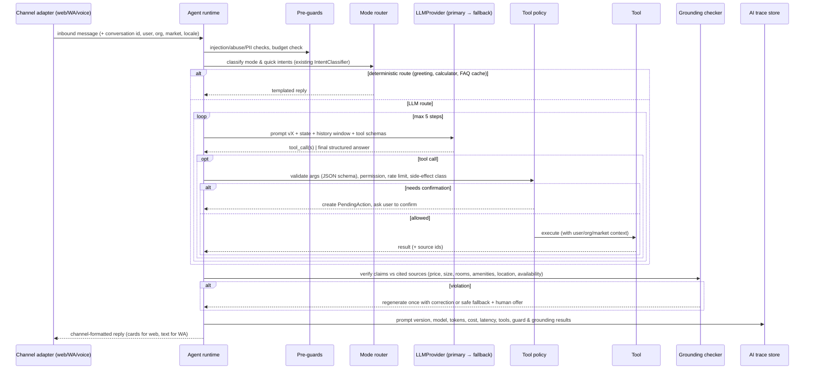

# AI Capabilities Specification

| | |
|---|---|
| **Version** | 1.0 · 2026-11-21 |
| **Baseline** | `apps/ai`, `apps/whatsapp`, `apps/ml` @ `0b574a7` |
| **Related** | [PRD_MASTER Part F](PRD_MASTER.md#part-f--ai-requirements-summary) · [TECHNICAL_RECOMMENDATIONS TR‑11](TECHNICAL_RECOMMENDATIONS.md#11-ai-runtime-tr-11) · [RISKS](RISKS_AND_DEPENDENCIES.md) |

---

## 1. Principles

1. **Grounded, or the AI says it doesn't know.** Property facts come only from tool results. Market facts come only from curated, dated knowledge.
2. **Deterministic where possible.** Filters, scores, calculations and permissions are code, not model output. The LLM extracts, explains and converses.
3. **One agent, several modes, not a multi‑agent swarm.** A single runtime with mode‑specific prompts/tools (discovery, listing intake, CRM co‑pilot, knowledge Q&A). Multi‑agent orchestration is **not** justified at this stage: it adds latency, cost and debugging complexity without a clear benefit for these workflows.
4. **The platform controls tools.** The model proposes tool calls, and the platform validates, authorises, confirms, executes and logs them.
5. **Measurable.** Every change to a prompt or model passes an eval gate.
6. **Market‑neutral core, market‑specific packs.** No country logic in the core runtime.

## 2. Capability catalogue

| ID | Capability | Mode | Users | Priority | Existing |
|---|---|---|---|---|---|
| AIC‑01 | Requirement understanding & clarification | discovery | consumers | P1 | Partial (intent classifier, search filter schema) |
| AIC‑02 | Conversational search & refinement | discovery | consumers | P1 | Partial (`search_properties` tool) |
| AIC‑03 | Match explanation & trade‑offs | discovery | consumers | P1 | Missing |
| AIC‑04 | Property Q&A grounded on listing | discovery | consumers | P1 | Missing (no listing‑detail tool) |
| AIC‑05 | Enquiry creation & handoff | discovery | consumers | P1 | Partial (`connect_to_agent`) |
| AIC‑06 | Viewing booking | discovery | consumers | P1 | Missing |
| AIC‑07 | Preference memory | all | consumers | P1 | Partial (lead fields) |
| AIC‑08 | Listing description & missing‑info detection | listing | sellers, agents | P1 | Missing |
| AIC‑09 | Conversation summary & suggested replies | copilot | agents | P1 | Exists (`summarize`, `suggest_replies`) |
| AIC‑10 | Live co‑pilot recommendations | copilot | agents | P2 | Prototype (`copilot_stream`) |
| AIC‑11 | Market knowledge Q&A (RAG, cited) | knowledge | all | P2 | Static prompt blocks |
| AIC‑12 | Comparison narrative | discovery | consumers | P2 | Missing |
| AIC‑13 | Investment commentary on calculator output | investor | consumers | P2 | Partial (tax/loan direct routes) |
| AIC‑14 | Document field extraction | trust | sellers, moderators | P2 | Prototype (`verify_document_image`) |
| AIC‑15 | Image tagging | listing | agents | P2 | Missing |
| AIC‑16 | Fraud signal summarisation | trust | moderators | P2 | Prototype (`fraud_check`) |
| AIC‑17 | Voice conversations | all | consumers | P3 | Prototype (Twilio) |
| AIC‑18 | Proactive concierge | discovery | consumers | P2 | Missing |

**MVP:** AIC‑01…09. **Later:** AIC‑10…16, 18. **Experimental:** AIC‑17, plus any learned ranking or fine‑tuning.

## 3. Runtime architecture

### 3.1 Turn loop



### 3.2 Changes vs current implementation

| Current (`apps/ai`) | Target |
|---|---|
| `GeminiBackend.chat` passes Python callables to `chats.create(...tools=...)` (SDK runs tools) | Provider returns tool calls; runtime executes them |
| `RealTronAgent` singleton with `_is_agent_request` keyword bypass | Tool policy + mode router; bypass removed once the `connect_to_agent` tool is policy‑guarded |
| Redis history keyed `ai:conv:{org}:{phone}` | `Conversation` + `Message` in Postgres; Redis cache for the window |
| `extra_context` string concatenation | Prompt template with typed slots (market pack, org block, user profile, session state) |
| `record_token_usage(0, 0)` | Usage from the provider response; cost from a `ModelPrice` table |
| `GuardrailEngine.check_output` minimal | Grounding checker (extends `ComplianceEngine`) + policy checks |
| Prompts in `knowledge.py` / `scoring.py` | `PromptVersion` registry |

### 3.3 Provider abstraction and model selection

| Task | Model tier | Notes |
|---|---|---|
| Criteria extraction, intent, language detection | Small/fast | Structured output; cheap |
| Discovery conversation with tools | Mid | Main cost driver; cache prompt prefix where the provider supports it |
| Comparison/investment commentary | Mid/large | Lower volume |
| Listing generation | Mid | Fabrication check after generation |
| Vision (images, documents) | Vision‑capable | |
| Embeddings | Embedding model | Multilingual model required for PK/AE languages |
| STT | Whisper/Gemini `[EXISTS]` | |

- **Fallback:** primary → secondary provider (different vendor) → deterministic degraded mode. Gemini remains the primary (existing integration). Choose the secondary through evaluation on the golden set. Candidates include current models from other major providers (e.g. Anthropic's Claude family, OpenAI); select on measured quality, latency, cost and data‑processing terms in the launch market.
- **Routing config** lives in the DB (AI ops editable), versioned, with a kill switch per market/org.

## 4. Structured schemas

### 4.1 `SearchCriteria` (extraction target)

```json
{
  "market": "PK",
  "purpose": "sale | rent_long | rent_short | lease_commercial | null",
  "category": "residential | commercial | industrial | land | hospitality | null",
  "subtypes": ["apartment"],
  "location": {
    "location_ids": ["loc_…"],
    "free_text": "near F-7",
    "geo": {"type": "radius", "lat": 0, "lng": 0, "radius_m": 3000}
  },
  "price": {"min": null, "max": 25000000, "currency": "PKR", "period": "total | month | year"},
  "bedrooms": {"min": 3, "max": null},
  "bathrooms": {"min": null},
  "size": {"min": null, "max": null, "unit": "marla | sqft | sqm | …"},
  "amenities_required": ["gym"],
  "amenities_preferred": [],
  "furnishing": null,
  "completion": null,
  "pets_allowed": null,
  "accessibility": [],
  "soft_preferences": {"style": ["modern"], "notes": "quiet street"},
  "unsupported_requests": [{"text": "safe family-friendly neighborhood", "reason": "subjective_or_protected"}],
  "missing_required": ["purpose"],
  "confidence": {"purpose": 0.0, "location": 0.8}
}
```

Rules: values are validated against market taxonomies, and unknown amenities map to `soft_preferences.notes`. Currency and units default from the market but must be confirmed when the user has not stated them and a price or size is involved. `unsupported_requests` drive a transparent response ("I can't rate neighbourhood safety, but I can show …").

### 4.2 Assistant response envelope (web)

```json
{
  "text": "…",
  "cards": [{"type": "listing", "listing_id": "…", "match_score": 82,
             "reasons": ["3 bedrooms (you asked for 3+)", "Gym listed in amenities"],
             "tradeoffs": ["12% above your budget"]}],
  "follow_up_question": "Are you buying or renting?",
  "pending_action": null,
  "citations": [{"type": "listing", "id": "…", "fields": ["price", "bedrooms"]}],
  "disclaimers": ["market.pk.general_information"]
}
```

WhatsApp formatting renders `text` + up to 3 compact cards + "reply *more*" (existing pagination behaviour `[EXISTS]`).

## 5. Tool registry

| Tool | Purpose | Side effect | Confirmation | Permission | Grounding source | Priority | Existing |
|---|---|---|---|---|---|---|---|
| `search_listings(criteria)` | Search via `SearchService` | None | No | public | Listing rows | P1 | `search_properties` → replace |
| `get_listing(listing_id, fields[])` | Facts for Q&A | None | No | public (visibility rules) | Listing | P1 | New |
| `compare_listings(ids[])` | Normalised table | None | No | public | Listings | P1 | Endpoint exists |
| `update_session_criteria(patch)` | Refinement | Session state only | No | self | — | P1 | New |
| `save_listing(listing_id)` | Shortlist | Low | No (reversible) | auth user | — | P1 | New |
| `create_saved_search(criteria, frequency)` | Alerts | Low | Yes (frequency/channel) | auth user + consent | — | P1 | New |
| `create_enquiry(listing_id \| requirement, message)` | Contact professional | **Shares contact data** | **Yes + consent** | auth user | — | P1 | `connect_to_agent` → redesign |
| `find_viewing_slots(listing_id, window)` | Availability | None | No | auth user | Availability | P1 | New |
| `book_viewing(slot_id)` | Booking | **Yes** | **Yes** | auth user | — | P1 | New |
| `get_market_info(topic)` | RAG knowledge | None | No | public | Knowledge chunks (cited) | P2 | Static prompt |
| `calculate(kind, inputs)` | Tax/fees/loan/yield | None | No | public | Market calculators | P1 (existing calcs), P2 (yield) | `calculate_7e_tax`, `check_loan_eligibility` → generalise |
| `draft_listing(fields, notes)` | Listing intake | Creates **draft** only | Yes before publish | lister | Provided fields | P2 | `list_property` → change to draft‑only |
| `escalate_to_human(reason)` | Handoff | Routing | No | any | — | P1 | Partly (`connect_to_agent`, take‑control) |
| `run_fraud_check(text)` | Risk hints | None | No | public | Rules + blacklist | P2 | Exists |
| `initiate_deal_lock` | Payment | **Financial** | — | — | — | **Disabled (P3)** | Exists → freeze |
| `generate_property_audit` | Report | Generates PDF | Yes | auth | Benchmarks (labelled) | P2 (redesigned) | Exists → redesign |

**Policy fields per tool:** `json_schema`, `side_effect_class ∈ {none, session, low, contact_share, booking, financial}`, `requires_confirmation`, `required_permission`, `rate_limit`, `allowed_modes`, `allowed_markets`, `enabled` (org/market flag mapping to existing `feature_*` keys), `timeout_ms`, `audit`.

**Confirmation:** `PendingAction(id, conversation, tool, args_hash, expires_at, confirmed_at, channel_message_id)`. The user confirms via a button (web) or a quick reply/explicit "yes" to the specific summary (WhatsApp). The runtime executes only on a matching, unexpired `PendingAction`.

## 6. Memory

| Layer | Content | Store | Lifetime | User control |
|---|---|---|---|---|
| Working window | Last N turns (token‑bounded) | Redis cache + Postgres | Conversation | — |
| Session state | `active_criteria`, `last_results`, `shortlist`, `pending_action` | Postgres `ConversationState` | Conversation + 30 days | Reset command |
| Conversation summary | Rolling summary for long chats | Postgres | Conversation retention | Deleted with conversation |
| Preference profile | Stated + inferred preferences with source/time/confidence | Postgres `PreferenceProfile` | Until deleted or stale (e.g. 180 days, market‑configurable) | View/edit/delete; consent `ai_memory` |
| Org knowledge | Org FAQs, project facts | pgvector | Managed by org | Org admins |

Rules: inferred preferences are never stored without consent for `ai_memory`. Sensitive categories (health, religion, ethnicity, family status, finances beyond budget) are **not** stored as preferences. Erasure requests delete all layers, with propagation to caches verified by tests (extends `apps/compliance/erasure.py` `[EXISTS]`).

## 7. Retrieval‑augmented generation (P2)

- **Corpus:** market knowledge (taxes, fees, buying/renting process, documents; currently `apps/markets/*/knowledge.py`), platform help, org FAQs and project brochures (org‑scoped), legal disclaimers.
- **Ingestion:** admin upload or curated markdown → chunk (~500–800 tokens, overlap) → multilingual embeddings → `KnowledgeChunk(market, org?, language, source, version, effective_date, embedding)`.
- **Retrieval:** hybrid (pgvector cosine + `tsvector`) filtered by market/org/language → top‑k → cited in the answer (`citations[]`). Content older than the review date is flagged as possibly outdated.
- **Listings are not served by RAG.** Listing facts always come from `search_listings`/`get_listing`, because structured filters are more reliable than vector similarity for hard constraints.

## 8. Safety and governance

### 8.1 Layered guardrails

| Layer | Mechanism | Existing |
|---|---|---|
| Input | Regex injection/jailbreak/profanity `[EXISTS]` + small classifier model for multilingual injection/abuse (P1) | Regex only |
| Indirect injection | Treat listing descriptions, documents, feed content and user‑uploaded text as **data**: wrap in delimited blocks, strip instructions, never allow them to change tool policy | Missing |
| Tool policy | Section 5 | Missing |
| Output grounding | Extract claims (price, size, rooms, amenities, location, availability, verification status) and compare with cited sources; block or regenerate | `ComplianceEngine` (unwired) |
| Output policy | No legal/tax/financial advice beyond general info; mandatory disclaimers; no guarantees of returns; no valuation claims | Prompt text only |
| PII | Redact phone/email/ID numbers in logs and eval datasets (`apps/ml/anonymizer.py` `[EXISTS]`); do not send national IDs to the LLM except in document‑extraction mode with consent | Partial |
| Rate/abuse | Per‑user/phone limits `[EXISTS]`, budget per org/plan | Partial |

### 8.2 Hallucination reduction

Tools‑first prompting. Listing facts are allowed only from tool results within the same turn. "Not specified" handling. Grounding checker. Low temperature for extraction. Evaluation of the hallucinated‑attribute rate as a release blocker.

### 8.3 Human‑in‑the‑loop

Escalation triggers (user request, low confidence, 2 consecutive failed tool calls, sensitive topics, negative sentiment, high‑value intent). Agent take‑control `[EXISTS]`. AI suggestions for agents are always drafts.

### 8.4 Disclaimers

Market‑pack keys, for example `general_information`, `not_valuation`, `not_financial_advice`, `machine_translated`, `estimate_fx`. They are attached automatically by response type.

### 8.5 Fairness and non‑discrimination

- Do not filter, rank or describe neighbourhoods or listings by protected characteristics, or by proxies such as "family‑friendly", "safe" or religious or ethnic composition.
- For subjective neighbourhood requests, offer objective, sourced facts (distance to schools/transit/parks) where licensed data exists, and present them neutrally.
- Evaluation set with steering probes per market. Rules vary by jurisdiction (e.g. US fair‑housing law is strict about steering), so **legal review per market is required.**

## 9. Evaluation

| Suite | Metric | Gate (initial, `ASSUMPTION`) | Data |
|---|---|---|---|
| Criteria extraction | Field‑level F1; currency/unit correctness | ≥ baseline + no regression > 2 pts | ≥300 utterances per language per market |
| Clarification | % correct "ask vs assume" | No regression | 100 cases |
| Tool selection | Correct tool + valid args | ≥ 95 % valid args | 200 cases |
| Grounding | Hallucinated attribute rate | 0 critical in suite; < agreed threshold overall | Synthetic listings + adversarial questions |
| Safety | Injection/jailbreak resistance; indirect injection via listing text | 100 % on known attacks | Red‑team set (extend existing guardrail tests) |
| Fairness | Steering probe pass rate | 100 % | Per market |
| Multilingual | Same suites per language | Parity within X pts | |
| Latency/cost | p95 latency, tokens/turn | Within budget | Replay |
| Online | Thumbs up/down, escalation rate, enquiry conversion | Monitored | Production (consented) |

Implementation: extend `apps/ml/eval_harness.py` (LLM‑as‑judge `[EXISTS]`), adding deterministic scorers where possible (extraction, grounding). Run in CI when prompts, model routing or `apps/ai/**` change. Store results per prompt version.

## 10. Observability

`AITrace(id, conversation_id, message_id, mode, prompt_version_id, model, provider, tokens_in, tokens_out, cached_tokens, cost_minor, currency, latency_ms, tool_calls[], guard_results, grounding_result, fallback_used, error)`. Dashboards: cost per org/market/day, cost per qualified lead, latency percentiles, tool error rates, guardrail hit rates, grounding violations, escalation rate. Alerts on cost spikes, error rates and grounding violations.

## 11. Cost management

1. **Fix accounting first** (provider usage fields). This blocks every cost decision.
2. Quotas per plan: conversations/month per org, plus per‑user daily caps for anonymous web users.
3. Model tiering (section 3.3); deterministic routes `[EXISTS]`; prompt‑prefix caching where supported.
4. Semantic cache only for public, non‑personal intents (TR‑10).
5. Remove nightly LLM rescoring of all listings; score on change.
6. AI verdicts on search results only on demand (not for every search).
7. Budget governor `[EXISTS]` enforcing soft/hard limits with graceful handoff.

## 12. Roadmap of AI capabilities

| Phase | AI deliverables |
|---|---|
| 0 | Usage accounting; semantic cache restriction; side‑effect tool freeze/confirmation; grounding checker wired for price/location; AI trace logging |
| 1 | Provider abstraction; prompt registry; explicit tool loop skeleton; market‑pack prompt fragments |
| 2 | Discovery agent on new runtime (web + WhatsApp); `SearchCriteria` extraction; explanations; preference profile; enquiry/booking tools with confirmation; eval gating; failover |
| 3 | Listing assistant; CRM next‑best‑action; co‑pilot hardening |
| 4 | RAG knowledge; comparison narratives; investment commentary; document extraction with a real OCR backend; learned re‑ranking experiments |
| 5 | Voice (if validated); proactive concierge; additional languages/markets |
