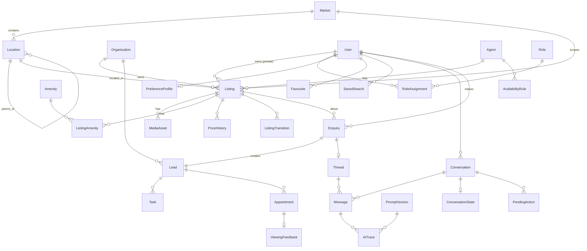

# API & Data Requirements

| | |
|---|---|
| **Version** | 1.0 · 2026-11-21 |
| **Related** | [EXISTING_SYSTEM_ASSESSMENT §6–7](EXISTING_SYSTEM_ASSESSMENT.md#6-existing-api-inventory) · [TECHNICAL_RECOMMENDATIONS §5–7](TECHNICAL_RECOMMENDATIONS.md) · [AI_CAPABILITIES_SPECIFICATION](AI_CAPABILITIES_SPECIFICATION.md) |

Labels: `[EXISTS]` keep · `[EXTEND]` modify · `[NEW]` add. All endpoints are under `/api/v1/` and follow the standards in TECHNICAL_RECOMMENDATIONS §7.

---

## 1. API capability map (future state)

| Domain | Endpoint group | Status | Priority |
|---|---|---|---|
| Auth | `auth/*` (OTP, password, refresh, me) | `[EXISTS]` + MFA, email login `[NEW]` | P1 |
| Access | `access/roles`, `access/assignments`, `access/me/permissions` | `[NEW]` | P0 |
| Markets | `markets/`, `markets/{code}`, `markets/{code}/taxonomies`, `fx/rates` | `[NEW]` | P0/P1 |
| Locations | `locations/search?q=`, `locations/{id}`, `locations/{id}/children` | `[NEW]` | P0 |
| Listings (pro) | `listings/` CRUD, `listings/{id}/transitions`, `/media`, `/price-history`, `/analytics` | `[EXTEND properties/]` | P0/P1 |
| Listings (public) | `public/listings/search`, `public/listings/{slug_or_id}` | `[NEW]` | P1 |
| Search | `search/` (POST criteria), `search/facets` | `[NEW]` (wraps SearchService) | P1 |
| Recommendations | `recommendations/for-me`, `listings/{id}/similar` | `[EXTEND]` | P1 |
| Compare | `compare/?ids=` | `[EXTEND properties/compare]` | P1 |
| Conversations | `conversations/`, `conversations/{id}/messages` (POST + SSE stream), `conversations/{id}/state`, `pending-actions/{id}/confirm` | `[NEW]` | P1 |
| Preferences & consent | `me/preferences`, `me/consents` | `[NEW]` / `[EXTEND compliance/consent]` | P1 |
| Favourites & saved searches | `me/favourites`, `me/saved-searches` | `[NEW]` | P1 |
| Enquiries | `enquiries/` (consumer create/list), org view through leads | `[NEW]` | P1 |
| CRM | `leads/*` `[EXISTS]` + `pipelines/`, `tasks/`, `contacts/` | `[EXTEND]` | P1 |
| Scheduling | `availability/`, `viewing-slots/`, `appointments/*` `[EXISTS]` + `feedback` | `[EXTEND]` | P1 |
| Messaging | `threads/`, `threads/{id}/messages` | `[NEW]` | P1 |
| Notifications | `notifications/*` `[EXISTS]` + devices (push tokens) | `[EXTEND]` | P1/P2 |
| Listing assistant | `listings/{id}/ai/describe`, `/ai/missing-info`, `/ai/extract` | `[NEW]` | P1 |
| Moderation | `moderation/queues`, `moderation/items/{id}/decision`, `reports/` (user reports) | `[NEW]` | P1 |
| Trust | `verification/*` `[EXISTS]` | `[EXTEND]` | P1 |
| Billing | `billing/*` `[EXISTS]` + `plans/`, `entitlements/`, `usage/` | `[EXTEND]` | P1 |
| AI ops | `ai/prompts`, `ai/prompt-versions`, `ai/models`, `ai/tools`, `ai/evals`, `ai/traces`, `ai/usage` `[EXTEND token-usage]` | `[NEW]` | P1 |
| Admin | `admin/users`, `admin/orgs`, `admin/markets`, `admin/audit-log` | `[EXTEND]` | P1 |
| Compliance | `compliance/*` `[EXISTS]` | `[EXTEND]` | P0 (launch market) |
| Investment | `calculators/{kind}` | `[EXTEND markets/calculators]` | P2 |
| Partner API | `external/*` `[EXISTS]` | `[EXTEND]` (listings feed v2 schema) | P2 |
| Frozen | `deals/*`, `payments/checkout*`, `marketplace/*`, `voice/*` | Feature‑flagged off | P3 |

### 1.1 Key endpoint contracts

**`POST /api/v1/search/`**
- Body: `SearchCriteria` (see AI spec §4.1) + `sort`, `cursor`, `limit ≤ 50`.
- Response: `{results: [{listing: ListingSummary, match_score, reasons[], tradeoffs[], sponsored: bool}], facets, next_cursor, criteria_echo, ranking_version}`.
- Errors: 400 field errors (e.g. `price.currency.unsupported`), 422 `location.ambiguous` with candidates.
- AuthZ: public. Visibility is enforced (published, market live, not sandbox).

**`POST /api/v1/conversations/{id}/messages`**
- Body: `{text, attachments[], client_message_id, locale?}`. Header `Idempotency-Key`.
- Response: SSE stream of `token`, `card`, `pending_action`, `final` events, or JSON when `stream=false`.
- Limits: per‑user rate limit; plan budget for org‑hosted assistants.

**`POST /api/v1/pending-actions/{id}/confirm`**
- Executes the stored tool call if the args hash matches and it has not expired. Returns the tool result. 409 if expired or already executed.

**`POST /api/v1/listings/{id}/transitions`**
- Body: `{to: "pending_review|published|…", reason?}`. 409 on an invalid transition. An audit entry is written and an outbox event emitted.

**`POST /api/v1/enquiries/`**
- Body: `{listing_id | requirement, message, contact_consent: true, preferred_channel}`. Creates or updates a Lead in the listing's org (existing routing state machine), notifies via the org's channel, and returns the thread id.

## 2. Domain entities (future state)

### 2.1 New and changed entities

| Entity | Key fields | Status | Pri |
|---|---|---|---|
| `Market` | code, name, status, default_currency, currencies[], languages[], default_units, timezones[], formats, listing_schema (JSON Schema), disclaimers{}, feature_flags{}, ai_policy{} | `[NEW]` (from registry) | P0 |
| `Currency`, `FxRate` | code, minor_units; base, quote, rate, source, as_of | `[NEW]` | P1 |
| `Location` | market, parent, level (region/city/locality/sub_locality/project), names{lang}, slug, aliases[], geom (polygon, nullable), centroid (point) | `[NEW]` | P0 |
| `Listing` (evolves `Property`) | + purpose, category, subtype, status (lifecycle), bedrooms, bathrooms, size_value/size_unit/size_m2, plot_size_m2, floor, total_floors, year_built, parking, furnishing, completion, pets_allowed, location_id, point (geography), address{}, location_precision, attributes (JSON validated by market schema), quality_score, published_at, expires_at, source, source_ref, licence_id, market_id | `[EXTEND]` | P0 |
| `ListingPrice` (embedded or 1:1) | amount_minor, currency, price_type, period, negotiable, deposit_minor, service_charge_minor, on_request | `[EXTEND]` | P0 |
| `PriceHistory` | listing, amount_minor, currency, changed_at, changed_by | `[NEW]` | P1 |
| `Amenity`, `ListingAmenity` | key, category, labels{lang}, markets[] | `[NEW]` | P0 |
| `MediaAsset` (generalises `PropertyImage`) | listing, kind (image/video/tour/floor_plan/document), storage_key, visibility, order, alt{lang}, tags[], phash, scan_status | `[EXTEND]` | P1 |
| `ListingTransition` | listing, from, to, actor, reason, at | `[NEW]` | P0 |
| `Mandate` | listing, agent/org, type (exclusive/open), valid_from/to, evidence_doc | `[NEW]` | P2 |
| `Project`, `ProjectUnit` | developer org, location, units with listing links | `[NEW]` | P2 |
| `Conversation`, `Message` | channel, participants, org, market, language; message role, content, cards, citations, prompt_version, trace_id | `[NEW]` (consolidates `ConversationMessage`, `WhatsAppMessage` gradually) | P1 |
| `ConversationState` | active_criteria, last_results, shortlist, pending_action_id | `[NEW]` | P1 |
| `PendingAction` | conversation, tool, args, args_hash, expires_at, confirmed_at, result | `[NEW]` | P0 |
| `ToolInvocation`, `AITrace` | see AI spec §10 | `[EXTEND AIInteraction/TokenUsageRecord]` | P0 |
| `PromptTemplate`, `PromptVersion`, `ModelRoute`, `ModelPrice` | key, mode, market, language, body, version, status; task → provider/model; price per 1k tokens | `[NEW]` | P1 |
| `KnowledgeDocument`, `KnowledgeChunk` | market, org?, language, source, version, effective_date, embedding | `[NEW]` | P2 |
| `PreferenceProfile`, `PreferenceItem` | user, market; key, value, source (stated/inferred), confidence, updated_at | `[NEW]` | P1 |
| `Favourite`, `SavedSearch`, `AlertDelivery` | user, listing; criteria, frequency, channel; delivered listings | `[NEW]` | P1 |
| `Enquiry` | user, listing or requirement, org, lead, consent_ref, status | `[NEW]` | P1 |
| `Thread`, `ThreadParticipant` | enquiry/lead link, participants, masked contacts | `[NEW]` | P1 |
| `PipelineStage`, `Task` | org, order, name; lead, assignee, due_at, status | `[NEW]` | P1 |
| `AvailabilityRule`, `AvailabilityException`, `ViewingSlot`, `ViewingFeedback` | agent, weekday, start/end, tz; slot; rating, notes | `[NEW]` | P1 |
| `Offer` | listing, lead, amount, currency, status, conditions | `[NEW]` | P2 |
| `Role`, `Permission`, `RoleAssignment` | scope_type, scope_id | `[NEW]` (replaces 3 membership tables over time) | P0 |
| `Plan`, `Entitlement`, `UsageRecord` | features, limits, prices per currency; metered usage | `[NEW]` (from enum + config) | P1 |
| `ModerationItem`, `UserReport` | subject type/id, reason, status, decision | `[NEW]` | P1 |
| `OutboxEvent` | type, payload, dispatched_at | `[NEW]` | P1 |
| `AuditEvent` | actor, action, subject, before/after hash, ip, at | `[EXTEND core.AuditLog]` | P1 |

### 2.2 Entities to retain as‑is (with hardening)

`Organization`, `OrganizationConfig`, `OrganizationTheme`, `DeveloperApiKey`, `Lead`, `LeadActivity`, `LeadScoreHistory`, `Appointment`, `Agent`, `FreelanceAgentProfile`, `Verification`, `DocumentScan` (encrypt PII), `FraudBlacklist`, `ConsentRecord`, `DataExportRequest`, `DataDeletionRequest`, `Campaign*`, `ReferralLink`, `Notification*`, `OrgSubscription`, `WebhookEvent`, `OrgWhatsAppConfig` (encrypt), `WhatsAppSession`, `ApiSecurityEvent`.

### 2.3 Entities to freeze (no new development)

`EscrowDeal`, `Payment` (deal‑lock usage), `SyndicationListing`, `BrokerNetworkPartnership`, `SyndicationLeadSubmission`, `CommissionLedgerEntry`, `VoiceCallSession`, `OrgVoiceConfig`, `AuditBenchmark`/`PropertyAudit` (until redesign).

## 3. Entity relationship diagram (core target)

## 4. Database requirements

| ID | Requirement | Pri |
|---|---|---|
| DB‑01 | PostgreSQL ≥ 15 with `postgis`, `pg_trgm` (P1), `vector` (P2) extensions in all environments, including CI | P1 |
| DB‑02 | All new tables use UUID PKs; all timestamps `timestamptz` UTC | P0 |
| DB‑03 | Lifecycle and transition rules enforced in services, plus a DB check constraint on allowed `status` values | P0 |
| DB‑04 | Indexes: `listing(market_id, status, purpose, category, price_amount)` partial on `status='published'`; GiST on `point`; GIN on `search_vector`; GIN trigram on location names; `(user_id, created_at)` on conversations/messages | P1 |
| DB‑05 | Expand/contract migrations for all renames; each migration reversible or explicitly marked | P0 |
| DB‑06 | PII columns inventoried in a data map; encrypted columns for secrets and national IDs | P0 |
| DB‑07 | Retention jobs per table class (messages, traces, OCR text, celery results) configured per market | P1 |
| DB‑08 | Backfill scripts with dry‑run and reports for: location matching, size rename, price split, membership consolidation, market_id | P0 |
| DB‑09 | Sandbox data separated by `is_sandbox` **and** excluded by default managers for public querysets | P0 |
| DB‑10 | Point‑in‑time recovery; restore tested quarterly | P1 |

## 5. External integrations and data sources

**Do not assume free or unrestricted access to any of these.** Every source needs terms review (storage, caching, display, attribution, AI processing) before use.

| Category | Purpose / value | Data | Method | Candidate options (non‑exhaustive) | Cost profile | Licensing / risk | Pri |
|---|---|---|---|---|---|---|---|
| **Listings — first party** | Core supply | Listings from agencies/developers | Dashboard, CSV import, partner API `[EXISTS external/inventory]` | — | Internal | Lister warrants rights to content/images | P0 |
| **Listings — licensed feeds** | Coverage | Portal/MLS/CRM feeds | Feed/API under agreement (inventory adapters `[EXISTS]`) | Market portals, agency CRMs, MLS/IDX (US) | Contract | Strict display/attribution; **scraping is not acceptable** | P2 |
| Maps & tiles | Map discovery | Tiles | JS SDK (frontend) | Google Maps Platform, Mapbox, OSM‑based providers | Usage‑based | Attribution; caching restrictions | P1 |
| Geocoding | Location normalisation | Address → coordinates | API, batch | Google, Mapbox, HERE, Nominatim (strict usage policy, self‑host for volume) | Usage‑based | Storage of results restricted by some vendors | P1 |
| POIs (transit, schools, healthcare) | Proximity, neighbourhood facts | POIs with categories | API or open data import | OSM/Overpass (ODbL), Google Places (storage limits), national open data | Low–medium | ODbL share‑alike obligations; Places caching limits | P2 |
| Neighbourhood statistics | Context | Demographics, crime (sensitive) | Licensed datasets | Government open data, commercial providers | Varies | Fairness/steering risk; legal review | P3 |
| Market data (transactions, rents) | Price context, investment | Sold prices, rent indices | Licensed | Land registries (e.g. HM Land Registry price‑paid open data in UK), DLD open data (Dubai), commercial AVM vendors | Varies | Valuation claims risk; licence terms | P3 |
| FX rates | Conversion | Daily rates | API | ECB reference rates, commercial FX APIs | Low | Display as indicative | P1 |
| Identity verification | Lister/agent trust | ID + liveness | SDK + webhook `[EXISTS Jumio/Onfido/Stripe Identity]` | Same | Per check | Biometric data laws | P1 (agents), P2 (private sellers) |
| Business/licence registries | Agent/agency verification | Licence numbers | API/manual | Companies House `[EXISTS]`, market regulators (e.g. RERA in Dubai) | Low | Availability varies | P1/P2 |
| Messaging — WhatsApp | Core channel | Messages, templates | Cloud API `[EXISTS]` | Meta Cloud API / BSPs | Per conversation (Meta pricing) | Opt‑in, template rules, 24 h window | P0 |
| Email | Notifications | Transactional mail | API | SES, SendGrid, Postmark | Low | Deliverability, consent for marketing | P1 |
| Push | Notifications | Device tokens | FCM/APNs | — | Low | — | P2 |
| SMS | OTP fallback | SMS | API | Twilio `[EXISTS for voice]`, local aggregators | Per message | Sender ID rules per market | P2 |
| Calendars | Viewing sync | Events | OAuth APIs | Google Calendar, Microsoft Graph | Free tier/API quotas | OAuth scopes review | P2 |
| Payments | Subscriptions | Charges | Stripe `[EXISTS]`, local gateways `[EXISTS Safepay/bSecure]` | Same | % fees | PCI handled by gateway; **no escrow without licence** | P1 (subs) |
| LLM providers | AI | Prompts, completions | API | Gemini `[EXISTS]` + secondary vendor | Per token | Data processing terms, residency, zero‑retention options | P0 |
| OCR | Documents | Text extraction | API | Cloud OCR services, Tesseract (self‑hosted) | Per page | Sensitive documents | P2 |
| Analytics | Product metrics | Events | SDK/server events | Self‑hosted or SaaS | Low–medium | Consent (cookies), PII minimisation | P1 |
| CRM integrations | Pro adoption | Leads/contacts | Webhooks/API `[EXISTS API keys]` | HubSpot, Salesforce, local CRMs | Low | Data processing agreements | P2 |
| Weather | Low value for core loop | — | — | — | — | **Not recommended** | — |

## 6. Data architecture principles

1. **Single source of truth per fact:** a listing fact lives in `Listing`; AI outputs reference it and never copy it.
2. **Provenance on derived data:** every computed or AI field stores `source`, `method`, `version` and `computed_at`.
3. **Market‑partitionable:** every tenant/consumer row carries `market_id`, enabling future residency without a redesign.
4. **Privacy by design:** minimise PII columns (phone is currently duplicated across many tables), and centralise contact data on `User`/`Contact`.
5. **Analytics separation:** product events are written to an append‑only events table or stream and exported to the warehouse later (P2). Reporting queries move to a read replica.
