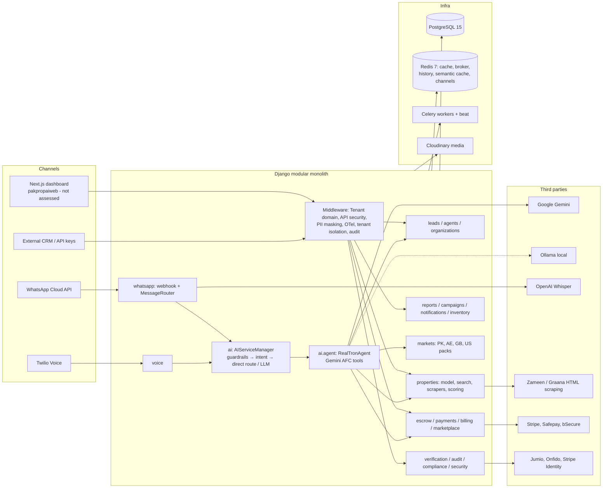
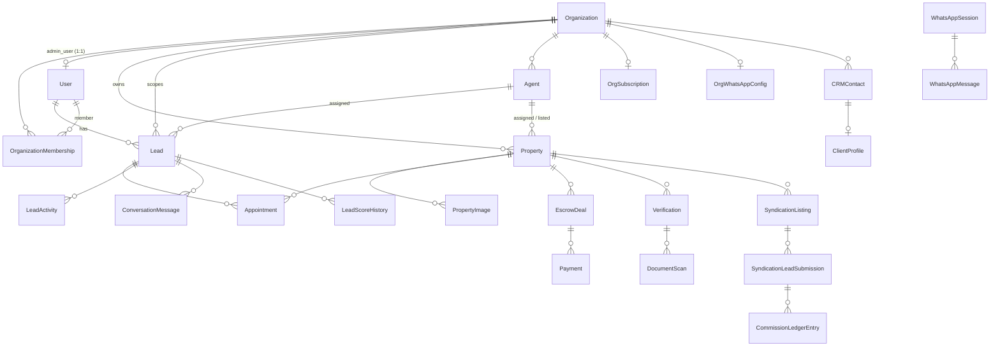
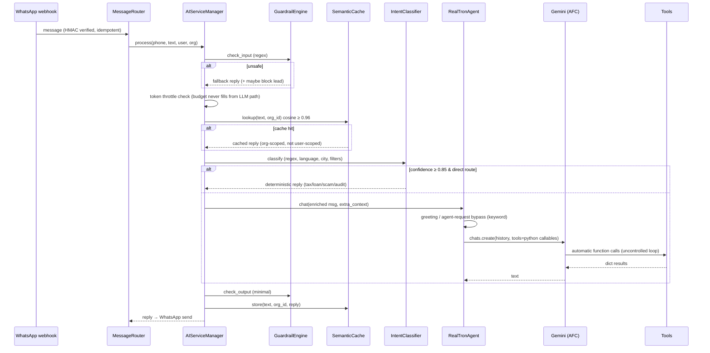

# Existing System Assessment — PakProp AI / RealTron AI Backend

| | |
|---|---|
| **Document** | EXISTING_SYSTEM_ASSESSMENT.md |
| **Version** | 1.0 |
| **Date** | 2026-11-21 |
| **Repository** | `pakpropai` (Django backend), branch `development`, commit `0b574a7` (89 commits) |
| **Scope** | Backend only. The sibling frontend repo `../pakpropaiweb` (Next.js) was **not** assessed. |
| **Related** | [PRD_MASTER](PRD_MASTER.md) · [FEATURE_GAP_ANALYSIS](FEATURE_GAP_ANALYSIS.md) · [TECHNICAL_RECOMMENDATIONS](TECHNICAL_RECOMMENDATIONS.md) |

> **Evidence convention.** Statements marked **[Verified]** were confirmed by reading the code. Statements marked **[Inferred]** are reasonable conclusions from code structure that were not executed. **[Not verified]** means the claim could not be checked in this assessment (e.g. runtime behaviour, third‑party API reality).
>
> **Test execution:** the test suite was **not run**. Django is not installed in the local environment and installing packages was out of scope. Test counts below are static counts only.

---

## 1. Executive Summary

The repository is a **Django 5.2 / DRF modular monolith** (26 local apps, ~45,000 lines of application Python excluding migrations, ~20,000 lines of tests, 1,435 test functions) that implements a **B2B2C, WhatsApp‑first AI real estate platform**. The README positions it as *"the trust infrastructure layer for Pakistani real estate"*. Code identifiers, the CI pipeline and default settings use the brand **RealTron AI** (`realtron.ai`); README and Celery use **PakProp AI**.

What it is today:

- A **multi‑tenant SaaS for real estate organizations** (developers, agencies, brokerages). Each organization connects its own WhatsApp Business number; an **AI assistant on WhatsApp** answers prospects, searches listings, qualifies leads, and hands conversations to human agents.
- A **CRM for agents** (leads, scoring, routing, appointments, conversation log, AI summaries and reply suggestions, live "co‑pilot" over WebSockets).
- A **trust layer**: document OCR via LLM vision, a human verification queue, trust certificates, fraud blacklist, ID‑verification provider integrations, AML sanction screening.
- **Transaction features**: "Deal Lock" (a token payment that reserves a property for 48 h) through Safepay, bSecure, Stripe, SEPA or manual transfer; developer→broker syndication with a commission ledger.
- **Market packs** for **Pakistan (deepest), UAE, UK and US** (tax/financing calculators, knowledge prompts, document types).

**Maturity verdict:** *Broad but shallow in its core real‑estate domain.* Platform plumbing (tenancy, security, observability, compliance scaffolding, billing, messaging) is unusually extensive for its size. The parts that matter most for an "AI real estate agent" — the **property data model, search, recommendation, and AI orchestration** — are the least mature. Examples: the `Property` model has **no bedrooms, bathrooms, sale/rent purpose, listing lifecycle, or amenities**; search relies partly on **scraping Zameen.com and Graana.com**; the LLM path records **zero tokens**, so the AI budget governor cannot work for LLM calls; there is **no web/app chat API**, because the AI is reachable only through WhatsApp and voice.

Overall maturity: **Late prototype / early beta (≈ 2 on a 1–5 scale)** for the AI real estate agent product. Detail in §15.

---

## 2. Current Product Capabilities

| Area | What exists (summary) |
|---|---|
| **Consumer channel** | WhatsApp Cloud API webhook (per‑org numbers, HMAC verification, idempotency, rate limit); voice notes transcribed (Gemini, Whisper fallback); images/documents analysed; Twilio voice calls with AI handling and agent barge‑in. |
| **AI assistant** | Gemini (`gemini-2.5-flash-lite` default) with automatic function calling over 8 tools; Ollama local backend; regex guardrails; deterministic intent classifier with direct (non‑LLM) routes for tax/loan/scam/audit; per‑market context injection; Redis conversation history (20 turns, 24 h). |
| **Listings** | `Property` + `PropertyImage`; ownership discriminator (organization / freelance agent / client / platform) enforced by DB constraint; reference numbers; area normalised to m²; legal‑status state machine; AI score & risk level; external inventory sync adapters. |
| **Search** | DB filter search (city, location, price, area ±20 %, type, furnished, construction, installments, legal status) + background scraping of Zameen/Graana cached in Redis; heuristic de‑duplication; one‑line AI "verdicts" for the top 5. Postgres full‑text search (computed per query) on the REST list endpoint. |
| **Recommendations** | Rule‑based lead→property scoring (city 40, type×intent 20, budget 25, AI score 15) and "similar properties". |
| **CRM** | Leads (routing state machine, scoring + history, intent, budget, activities), appointments, duplicate detection/merge, bulk/auto assignment, stale‑lead reminders, follow‑up automation, re‑engagement, AI summarise/suggest replies, live WebSocket co‑pilot, take/release WhatsApp control. |
| **Organizations** | Registration with OTP, white‑label custom domains and themes, per‑org feature flags, membership roles, developer API keys (hashed, scoped), sandbox→production provisioning of WhatsApp. |
| **Trust & verification** | DocumentScan (LLM OCR), verification queue with reviewer, trust certificate, fraud check, fraud blacklist, Jumio/Onfido/Stripe Identity webhooks, UK Companies House agent verification. |
| **Transactions** | Deal Lock (escrow‑like token reservation), payment checkouts and webhooks (Safepay, bSecure, Stripe, SEPA), syndication marketplace with hash‑chained commission ledger. |
| **Monetization** | Org subscription plans (trial/basic/professional/enterprise) via Stripe and local gateways; trial limit of 10 properties. |
| **Engagement** | WhatsApp template campaigns, referral links ("viral hooks"), notifications with user preferences. |
| **Analytics** | Lead/agent/property/deal/revenue/bot/funnel reports, PDF reports, monthly reports, WhatsApp token usage, property audits with PDF. |
| **Compliance** | Consent records, data export, deletion/right‑to‑be‑forgotten, PII masking middleware, PII detection events, AML sanctions sync, privacy audit log, optional regional DB routing (EU/UK/UAE). |
| **Ops** | Prometheus, Grafana dashboard, OpenTelemetry, Sentry, JSON logs with tenant context, circuit breakers, chaos scripts, k6 load tests, GitHub Actions CI/CD to GHCR + AWS ECS. |

**Intended users today [Inferred]:** organization staff (owners, admins, managers, agents, freelance agents), platform admins with sub‑roles, and end clients who talk to the AI **only via WhatsApp/voice**. `PropertyViewSet.get_permissions` comments say *"Clients … are WhatsApp‑only and must not submit via API."*

---

## 3. Existing Architecture

### 3.1 Style

- **Modular monolith** on Django; apps are the module boundary. Cross‑app imports are frequent and frequently **function‑local** (`from apps.x import y` inside functions) to avoid circular imports. That shows boundaries are not enforced. **[Verified]**
- **Synchronous HTTP (WSGI/gunicorn)** for REST; **ASGI (Daphne + Channels)** for WebSockets (`ws/agent/org/<id>`, `ws/agent/copilot/session/<id>`, `ws/voice/stream/<sid>`, `ws/voice/room/<id>`). **[Verified]**
- **Celery** with two queues (`default`, `high-resource`) and ~20 beat schedules (deal‑lock expiry, nightly rescoring, stale leads, reminders, campaign dispatch, inventory sync every 15 min, tenant queue monitor every 30 s, AML sync weekly…). **[Verified]**
- **Service layer** pattern in places (`services.py`, `*Service` classes), but much business logic lives in views and tool functions. **[Verified]**

### 3.2 Architecture diagram (as‑is)

### 3.3 Module inventory (26 local apps)

| App | LOC* | Responsibility |
|---|---:|---|
| `ai` | 5,791 | Agent, service manager, guardrails, intent classifier, tools, context builder, token governor, output compliance filters, backends |
| `whatsapp` | 3,842 | Webhook, router, sessions, media/STT, co‑pilot stream, consumers, provisioning, discovery referrals |
| `properties` | 2,789 | Property model, search, scrapers, scoring, recommendations, financial calcs |
| `verification` | 2,663 | Document scans, verification queue, fraud, IDV providers, trust certificates |
| `audit` | 2,189 | Property audits (benchmarks → PDF), security traces, compliance violations |
| `organizations` | 2,139 | Tenancy, config flags, memberships, API keys, themes, payment settings |
| `compliance` | 1,734 | Consent, export, erasure, PII, AML, regional router |
| `reports` | 1,634 | Analytics endpoints and PDF reports |
| `core` | 1,602 | Middleware, permissions, throttles, health, audit log, seed data |
| `agents` | 1,591 | Agent profiles, freelance, availability, leaderboard, memberships |
| `leads` | 1,551 | Leads, activities, appointments, messages, CRM contacts |
| `payments` | 1,438 | Checkouts and webhooks for deal‑lock payments |
| `markets` | 1,383 | Market registry, calculators, knowledge per country |
| `campaigns` | 1,287 | Broadcast campaigns, referrals, re‑engagement |
| `billing` | 1,118 | Org subscriptions, webhooks |
| `voice` | 1,112 | Twilio calls, streaming, barge‑in |
| `inventory` | 1,059 | External platform sync (Zameen, Bayut, Rightmove, generic REST) |
| `marketplace` | 854 | Syndication, partnerships, commission ledger |
| `escrow` | 841 | Deal Lock |
| `ml` | 831 | Dataset curation, anonymiser, LLM‑as‑judge eval harness |
| `security` | 720 | API security middleware, hash‑chained security events |
| `observability` | 653 | OTel middleware, metrics, traces |
| `resilience` | 498 | Circuit breakers, fallbacks, SLA status |
| `notifications` | 317 | In‑app notifications and preferences |
| `config` | 304 | `SystemConfig` key/value platform settings |
| `infra` | 96 | Regional DB router |

\*Non‑migration Python lines.

---

## 4. Technology Stack [Verified from `requirements/base.txt`, settings, Docker, CI]

| Layer | Technology |
|---|---|
| Language/runtime | Python 3.12 (Docker, CI) |
| Framework | Django 5.2.14, DRF 3.15.2, SimpleJWT 5.3.1 (blacklist), django‑cors‑headers |
| Async/real‑time | Channels ≥4.1, channels‑redis, Daphne |
| DB | PostgreSQL 15 (psycopg 3); optional regional DB aliases `eu_cluster`, `uk_cluster`, `uae_cluster` |
| Cache/broker | Redis 7 (cache, Celery broker, Channels layer, AI history, semantic cache) |
| Jobs | Celery 5.4, django‑celery‑beat (DB scheduler), django‑celery‑results |
| AI | `google-genai` (Gemini), Ollama HTTP (`qwen2.5:7b`, `llava:7b`), `openai` (Whisper STT), `sentence-transformers` (all‑MiniLM‑L6‑v2) + numpy, pydantic v2 |
| Scraping | requests, beautifulsoup4, lxml |
| Media | Pillow, Cloudinary storage (local disk fallback) |
| Docs/PDF | reportlab, qrcode |
| Payments | stripe, Safepay & bSecure via REST |
| Comms | WhatsApp Cloud API (REST), Twilio |
| Observability | sentry‑sdk, django‑prometheus, OpenTelemetry SDK/OTLP, python‑json‑logger |
| Static | whitenoise |
| CI/CD | GitHub Actions: Bandit, TruffleHog, pytest + coverage, GHCR and AWS ECR builds, ECS rolling deploy |
| Hosting docs | Render, Railway, VPS (README); AWS ECS (CI) |

**Notable absences [Verified]:** no PostGIS, no pgvector or other vector store, no search engine (OpenSearch/Elasticsearch/Typesense), no OpenAPI schema generator, no email provider integration (console backend in dev), no push notifications, no field‑level encryption library.

---

## 5. Existing Feature Inventory

Status legend: **OPERATIONAL** (implemented and operational) · **IMPROVE** (implemented, needs improvement) · **PARTIAL** · **PROTOTYPE** · **PLANNED** (documented only) · **MISSING** · **DEPRECATE** (deprecated/unnecessary for the product direction).

"Operational" here means *complete in code, with validation, error handling and tests*. Runtime operation was not verified (see header).

### 5.1 Identity, tenancy, access

| Feature | Status | Evidence / notes |
|---|---|---|
| Phone‑first user (E.164 username), OTP via WhatsApp, password login, reset | OPERATIONAL | `apps/users`; OTP via `secrets`; attempts ≤5; 3/hour throttle |
| JWT via cookie or header, refresh + blacklist | OPERATIONAL | `JWTCookieOrHeaderAuthentication`, SimpleJWT blacklist |
| Email login / social login / MFA | MISSING | No email‑based auth or TOTP |
| Global role enum (`client/agent/developer/admin`) + `platform_role` | IMPROVE | Hardcoded roles; checked in views via `user.role == ...` |
| Org membership RBAC (`OrganizationMembership` with 8 roles) | PARTIAL | Docstring says querysets switch "when `USE_MEMBERSHIP_RBAC` is enabled", but the flag is not referenced anywhere else. Overlaps with `AgentOrgMembership`, `AgentOrganizationMembership`, `Agent.organization`, `Organization.admin_user` (OneToOne). |
| Multi‑tenancy by `organization` FK + `TenantIsolationMiddleware` | IMPROVE | Row‑level by convention; cross‑org isolation tests exist |
| White‑label domains & themes | OPERATIONAL | `TenantDomainMiddleware`, `OrganizationTheme` |
| Developer API keys (PBKDF2, scopes, expiry) | OPERATIONAL | `DeveloperApiKey`; external leads/inventory endpoints |
| PK‑specific user fields (`is_filer`, `ntn`, `cnic`) on global `User` | DEPRECATE (move) | Should live in a market‑specific profile |

### 5.2 AI assistant

| Feature | Status | Evidence / notes |
|---|---|---|
| WhatsApp conversational AI with tool calling | IMPROVE | `AIServiceManager.process` → `RealTronAgent.chat`; Gemini AFC runs tool loop inside SDK, so the platform cannot intercept individual tool calls |
| Web/app chat API for consumers | MISSING | No REST/WebSocket consumer chat endpoint; AI is WhatsApp/voice only |
| Intent classification (deterministic) + direct routes | OPERATIONAL | Regex `IntentClassifier`; direct tax/loan/scam/audit at confidence ≥ 0.85 |
| Rule‑based "connect to agent" bypass | IMPROVE | Keyword matching with hardcoded Pakistani cities/areas, crore/lakh parsing |
| Natural language → structured search | PARTIAL | `PropertySearchFilter` (pydantic) + LLM tool args; schema lacks beds/baths/purpose/amenities |
| Conversation memory (short‑term) | IMPROVE | Redis list, 20 turns, 24 h TTL, 2,000‑char truncation; not durable |
| Long‑term preference memory | PARTIAL | Only Lead fields (`intent`, `budget_*`, `city_interest`, `intent_signals`) |
| Multilingual | PARTIAL | English + Roman Urdu heuristics; `Organization.language` (6 languages) injected into context |
| Input guardrails (injection, jailbreak, profanity, off‑topic) | IMPROVE | Regex‑based `GuardrailEngine`; blocks lead on severe hits |
| Output guardrail | PROTOTYPE | `check_output` is a minimal sanity check |
| Output grounding check (price/currency/installment/location vs DB) | PROTOTYPE | `ComplianceEngine` in `ai/compliance_filters.py` is implemented and tested but **not called** by the AI pipeline |
| Token budgets per org | PARTIAL / defective | `SlidingWindowTokenBudget` exists, but the LLM path calls `record_token_usage(tokens_in=0, tokens_out=0)`, so budgets never fill from LLM traffic |
| Semantic response cache | IMPROVE (risk) | MiniLM embeddings, cosine ≥0.96, scoped **per org, not per user**. A personalised answer can be returned to a different user with a similar message (see §13) |
| Prompt management/versioning | MISSING | Prompts are Python string constants |
| Model fallback | PARTIAL | Circuit breaker returns a canned message; there is no secondary model |
| RAG / knowledge retrieval | MISSING | Static market knowledge blocks in the prompt |
| AI evaluation | PROTOTYPE | `apps/ml` eval harness (LLM‑as‑judge), offline command; not in CI |
| AI interaction logging | IMPROVE | `AIInteraction` logs every chat as `intent_classify` with 0 tokens |
| Voice AI (Twilio) with barge‑in | PROTOTYPE | Implemented with tests; production readiness not verified |
| Agent co‑pilot (live suggestions) | PROTOTYPE | `copilot_stream.py` keyword + intent based recommendations via WebSocket |
| Lead summary & suggested replies | IMPROVE | `LeadViewSet.summarize/suggest_replies` |

### 5.3 Listings and search

| Feature | Status | Evidence / notes |
|---|---|---|
| Listing CRUD with ownership constraint | IMPROVE | Solid ownership model; serializer validation is thin |
| Listing purpose (sale/rent/lease) | MISSING | `SearchParams.purpose` is commented *"reserved for future filter"* |
| Bedrooms, bathrooms, amenities, floor, parking, year built | MISSING | Not in `Property` |
| Listing lifecycle (draft→review→published→expired) | MISSING | Only `is_active` |
| Moderation of listings | PARTIAL | Legal‑status verification queue exists; no content moderation |
| Images | IMPROVE | Max 10 × 5 MB; type check by declared MIME; no malware scan or EXIF stripping found |
| Video, virtual tours, floor plans, documents | MISSING | `raw_docs` JSON only |
| Price history | MISSING | |
| Rent price period / deposits / service charges | MISSING | Single `price` BigInteger |
| Area units & m² normalisation | OPERATIONAL | 7 units; field misleadingly named `area_marla` |
| Geo coordinates | PARTIAL | `latitude/longitude` decimals; no spatial index; no radius/polygon search in property search |
| Structured DB search | IMPROVE | `icontains` matching on city/location/type; top 10 by `ai_score` |
| Full‑text search | IMPROVE | `SearchVector` computed per request; no GIN index |
| Scraped portal results (Zameen, Graana) | DEPRECATE / high risk | HTML scraping with a spoofed browser User‑Agent; ToS/licensing exposure (see risks) |
| Sandbox isolation in search | DEFECT | `PropertySearchService._from_db` does not filter `is_sandbox`; demo listings can appear in live searches **[Verified: no `is_sandbox` filter in search/views]** |
| De‑duplication | PROTOTYPE | Heuristic across sources at query time; no persistent duplicate detection |
| Recommendations | PROTOTYPE | Rule‑based scoring, no behavioural signals, no explanation output |
| Saved searches / alerts / favourites | MISSING | |
| Comparison | PARTIAL | `GET /properties/compare/` returns raw details for ≤4, agents/admins only, no AI analysis |
| Market trends | PROTOTYPE | Average list price by `created_at` month from own listings; not transaction data |
| AI property score & risk | PROTOTYPE | LLM prompt as "Pakistani real estate investment analyst"; nightly rescoring of all properties |
| External inventory sync | PROTOTYPE | Adapters for Zameen, Bayut, Rightmove, generic REST. Endpoints and field maps assume partner APIs whose availability/terms are **not verified** |
| Property audit report (PDF) | IMPROVE | Admin‑curated `AuditBenchmark` ranges → grade A–D; needs data provenance & disclaimers |

### 5.4 CRM, communication, scheduling

| Feature | Status | Notes |
|---|---|---|
| Leads with routing state machine, scoring, history | OPERATIONAL | Strong foundation |
| Auto‑assignment, bulk assign, duplicates, merge | OPERATIONAL | |
| Stale‑lead detection, reminders, follow‑up automation, re‑engagement | IMPROVE | Beat jobs; effectiveness unmeasured |
| Appointments (schedule/confirm/cancel/reschedule/complete) | IMPROVE | No time‑zone per participant, no calendar sync, no availability slot engine |
| Agent availability | PARTIAL | Availability endpoint; not tied to slot booking |
| Conversation log (WhatsApp + dashboard) | OPERATIONAL | `ConversationMessage`, `WhatsAppMessage` (duplicated logs) |
| Human handover (take/release control) | OPERATIONAL | Orphan session revert job every 60 s |
| In‑app buyer↔agent messaging (non‑WhatsApp) | MISSING | |
| Email / SMS / push notifications | MISSING / PARTIAL | In‑app `Notification` + preferences; WhatsApp delivery; no email/push provider |
| Campaigns (WhatsApp templates) | OPERATIONAL | Tiered, scheduled, concurrency‑tested |
| Referral links | OPERATIONAL | Public endpoints, throttled |
| Calendar integrations | MISSING | |

### 5.5 Trust, transactions, billing, compliance

| Feature | Status | Notes |
|---|---|---|
| Document OCR via LLM vision | PROTOTYPE | Default OCR backend is `stub`; LLM extraction is unverified for accuracy |
| Verification queue + trust certificate | IMPROVE | Human reviewer workflow exists |
| Fraud check, blacklist, flagged users | PROTOTYPE | LLM + keyword rules |
| IDV providers (Jumio, Onfido, Stripe Identity) | PROTOTYPE | Provider classes + webhooks; production contracts not verified |
| Deal Lock (token reservation, 48 h) | PROTOTYPE / regulated | Platform‑mediated holding of buyer funds may be regulated escrow/payment activity in many markets |
| Payment gateways (Safepay, bSecure, Stripe, SEPA) | PROTOTYPE | Webhooks with idempotency |
| Org subscriptions (Stripe + local) | IMPROVE | Plans hardcoded as enum; usage metering incomplete |
| Syndication & commission ledger | PROTOTYPE | Hash‑chained ledger |
| Consent, export, erasure/RTBF, PII masking | IMPROVE | Good scaffolding; legal adequacy not assessed |
| AML sanction screening | PROTOTYPE | Weekly list sync |
| Regional data residency routing | PROTOTYPE | Router + optional DB aliases; no evidence clusters exist |
| Secrets in DB | DEFECT | `SystemConfig`, `OrgWhatsAppConfig.access_token/app_secret`, `OrgPaymentSettings` secrets and `OrgVoiceConfig.auth_token` are plain `CharField`s. No encryption library was found in the repo. |

### 5.6 Platform operations

| Feature | Status | Notes |
|---|---|---|
| Django admin | OPERATIONAL | Default admin |
| Platform admin APIs (org suspend/activate, config) | IMPROVE | |
| AI ops admin (prompts, models, evals) | MISSING | `IsAIAdmin` permission exists, no AI management endpoints beyond token stats |
| Observability (Prometheus, OTel, Sentry, JSON logs) | OPERATIONAL | Grafana dashboard and alert rules in `ops/` |
| Circuit breakers / SLA status | IMPROVE | |
| CI/CD | DEFECT | See §13: CI paths assume a parent monorepo |

---

## 6. Existing API Inventory

All business APIs are mounted under **`/api/v1/`** ([`config/urls.py`](../../../config/urls.py)). Default authentication is JWT (cookie or `Authorization: Bearer`). Default permission is `IsAuthenticated`. Pagination is `PageNumberPagination` (20). There is a custom exception handler. Global throttles are anon 30/min and user 120/min, plus 12 scoped throttles.

| Module (prefix) | Key endpoints (methods) | Auth / permissions | Notes |
|---|---|---|---|
| `auth/` | `csrf/`, `otp/send/` (POST), `otp/verify/` (POST), `token/refresh/`, `me/` (GET/PATCH), `me/notification-preferences/`, `logout/`, `users/` + `users/<uuid>/`, `login/`, `registration/verify-otp/`, `password/reset/request|confirm/`, `password/change/` | Public for OTP/login; admin for `users/` | `users/` list and detail share one view class |
| `organizations/` | `register/`, `register/verify-otp/`, list, `me/`, `me/config/[<key>]`, `me/dashboard/`, `me/ai-stats/`, `me/theme/`, `me/members/[<id>]`, `<uuid>/suspend|activate|config/` | Org admin / platform admin | |
| `external/` | `keys/`, `keys/<uuid>/`, `leads/`, `leads/<uuid>/`, `inventory/` | API key with scopes | B2B integration surface |
| `leads/` | ViewSet CRUD + actions `stats`, `suggest_agents`, `assign`, `auto_assign`, `conversations`, `send_message`, `summarize`, `suggest_replies`, `activities`, `score_history`; `appointments/` ViewSet + `confirm|cancel|reschedule|complete`; `duplicates/`, `bulk-assign/`, `merge/` | Org members | Richest module |
| `agents/` | list, `me/`, `me/availability/`, `freelance-profile/`, `available/`, `leaderboard/`, `register/`, `verify-companies-house/`, `team/[<id>]`, `<id>/`, `<id>/approve|reject|availability|stats/` | Mixed | Integer PKs, while most other entities use UUIDs |
| `properties/` | ViewSet CRUD + image upload/delete + scoring actions; `compare/`, `market-trends/` | Authenticated; create = agent/developer/admin | **Route‑order issue [Inferred]:** the router registers `r''` before `compare/` and `market-trends/` are appended. `GET /properties/compare/` may therefore resolve to the detail route `/<pk>/` with pk="compare", depending on the router's pk regex. Needs a test. |
| `deals/` | list, `mine/`, `lock/`, `lock/<uuid>/` + `confirm|cancel|seller-confirm|release|dispute/` | Mixed | |
| `payments/` | list, `checkout/<deal>/`, `sepa/<deal>/`, `return/`, 5 gateway webhooks | Webhooks public + signature | |
| `billing/` | `usage/`, `checkout/`, `portal/`, `invoices/`, `payment-settings/`, 3 webhooks | Org admin | |
| `verification/` | `fraud-check/`, `queue/[<uuid>]`, `<property>/certificate/`, `bulk-reject/`, `documents/…`, `id-verify/`, 3 IDV webhooks, `fraud/stats|alerts|blacklist|users/` | Mixed | |
| `audit/` | list, `download/<id>/`, `benchmarks/[<id>]` | | Name collides with `core` `audit-log/` and `security` events |
| `reports/` | 11 analytics GETs, `generate/`, `mine/`, `<uuid>/`, `<uuid>/download/` | | |
| `notifications/` | list, `mark-read/` | | `whatsapp/history/` serves a second "notification" listing |
| `campaigns/` | ViewSet + `templates/` | | |
| `compliance/` | `consent/`, `export/`, `my-data/`, `privacy-audit/[export/]`, `rtbf/…`, `pii-detections/summary/`, `screenings/…`, `sanctions/…` | | |
| `whatsapp/` | `webhook/` (GET verify, POST), `history/`, `config/` + `verify|test-message|sync/`, `sessions/<uuid>/take-control|release-control/` | Webhook public + HMAC | |
| `provisioning/` | `status/`, `start/`, `retry/` | | |
| `ai/` | `token-usage/`, `token-budget/` | | No chat, prompt or eval endpoints |
| `inventory/` | `connections/` ViewSet, `conflicts/` ViewSet | | |
| `marketplace/` | `listings/`, `partnerships/`, `submissions/`, `ledger/`, `browse/` | | |
| `voice/` | `webhook/inbound/`, `calls/initiate/`, `calls/`, `calls/<sid>/[barge-in/]`, `config/` | | |
| `security/` | `events/`, `chain-verify/` | Platform admin | |
| `observability/` | `metrics/`, `traces/`, `health/` | | Also root `/metrics/` (IP‑restricted) |
| `sla/` | `status/`, `circuits/<svc>/reset/` | | |
| `config/`, `theme/` | System config, theme | | |
| Root | `/health/`, `/admin/`, `/metrics/`, `/public/verify/`, `/public/referral/convert/`, `/public/platform-stats/` | | |

**API design observations**

1. **No public consumer listing API.** All property endpoints require authentication. There are no SEO‑friendly public listing or search endpoints.
2. **No OpenAPI/Swagger schema**, so API contracts are implicit.
3. **Inconsistent identifiers:** UUID for most entities, integer for `Agent`, `DocumentScan`, `PropertyAudit`, `OrganizationMembership`.
4. **Inconsistent naming:** `deals/lock/…` vs `escrow` app; three "audit" concepts; two notification listings; `history/` under WhatsApp.
5. **Versioning:** a single `/api/v1/` prefix with no deprecation policy. Acceptable now.
6. **Role checks inside views** (`user.role == 'developer'`) are repeated across modules instead of central policy objects.
7. **Validation:** query params are cast with bare `int()` in `PropertyViewSet.get_queryset`, so non‑numeric input produces a 500 instead of a 400. **[Verified]**
8. **No idempotency keys** on POSTs that create payments or deal locks (webhooks are idempotent, client calls are not). **[Inferred]**

---

## 7. Existing Data Model

### 7.1 Entity overview (60 models)

### 7.2 Assessment

| Dimension | Finding |
|---|---|
| **Normalisation** | Generally reasonable. Denormalised strings for `city`/`location` (free text) prevent consistent geography. `phone` is duplicated across `User`, `CRMContact`, `ClientProfile`, `WhatsAppSession`, `DocumentScan`, `PropertyAudit`, `SecurityTrace`, so PII is spread across many tables. |
| **Integrity** | Good: ownership `CheckConstraint`, legal‑status transitions in `clean()` (only enforced when `full_clean` is called, not on `save()`), `unique_together` on memberships. Weak: status transitions for deals/appointments are enforced in views; `organization_id` stored as `CharField` in `SecurityTrace` and `ComplianceViolation` (no FK). |
| **Indexing** | Basic single‑column indexes on `Property` (city, price, type, ai_score…). Missing: composite search index (`country, city, purpose, type, price`), GIN index for full‑text, spatial index, trigram index for `icontains`. |
| **Money** | `BigIntegerField` + ISO 4217 code: good, but there is no minor‑unit convention (PKR has none in practice, USD/GBP do) and no FX snapshot for cross‑currency comparison. |
| **Multi‑country** | `country` (ISO‑3166 alpha‑2) on Property and Organization; currency fields; area units incl. marla/kanal/guntha/cent; market registry for PK/AE/GB/US. Defaults remain Pakistan (`PKR`, `PK`, `marla`, `TIME_ZONE='Asia/Karachi'`, city codes map). |
| **Missing entities** | Listing purpose/terms, amenities taxonomy, location hierarchy (country → region → city → locality → sub‑locality), project/development (off‑plan units), price history, saved search, favourite, alert, offer, conversation (AI), preference profile, prompt versions, knowledge documents/embeddings, consent per purpose (exists partially), media assets beyond images. |
| **Scalability** | Fine for tens to hundreds of thousands of listings on Postgres. The nightly "rescore all properties" via LLM grows linearly in cost. Celery results are stored in the DB (`django-db`), which grows unbounded unless pruned. |
| **Privacy** | National ID numbers stored in clear (`User.cnic`, `DocumentScan.cnic_number`, `raw_ocr`); secrets in clear (see §5.5); AI `input_data`/`output_data` stores message excerpts; generated audit PDFs committed under `media/audits/`. |
| **Migration risk** | 160+ migrations; several apps have 10–22 migrations, which indicates churn. Renaming `area_marla`, splitting `price`, and consolidating membership tables are the riskiest changes and need expand/contract migrations. |

---

## 8. Existing AI Implementation

### 8.1 Request pipeline (WhatsApp text)

### 8.2 Tools available to the LLM

| Tool | Side effect | Confirmation enforced in code? | Notes |
|---|---|---|---|
| `search_properties` | Read (+ queues scrape) | n/a | Args: city, type, area_marla, max_price (docstring says "Pakistani Rupees"), location, furnished, construction |
| `list_property` | **Creates listing** | No (prompt only) | Prompt instructs to confirm details first |
| `run_fraud_check` | Read/LLM | n/a | |
| `calculate_7e_tax` | Calculation | n/a | Pakistan‑specific name |
| `check_loan_eligibility` | Calculation | n/a | |
| `connect_to_agent` | Creates/updates lead, assigns agent | No | Also invoked by a keyword bypass |
| `initiate_deal_lock` | **Creates deal, shares payment details** | No (prompt only) | Financial side effect |
| `generate_property_audit` | Generates PDF, sends WhatsApp | No | |

Tool context (user, phone, org) is passed via `contextvars` (`set_context`), which is good for isolation. **Because Gemini AFC executes tools inside the SDK, the platform cannot enforce per‑call authorization, confirmation, argument validation, or audit logging at the tool boundary.**

### 8.3 Strengths

- Cost‑aware design: deterministic direct routes, greetings without LLM calls, top‑5‑only AI verdicts, semantic cache, local model option.
- Market‑aware context (`DynamicContextBuilder` with org, lead and market blocks).
- Explicit anti‑hallucination intent (agent details never left to the model).
- Guardrails with security tracing and admin alerts; resilience circuit breaker.
- An eval harness and dataset curator exist as a starting point.

### 8.4 Weaknesses

- Single provider in practice; canned fallback instead of model failover.
- No structured output contract for the final answer; free text for WhatsApp.
- Token accounting is broken for LLM calls (0/0), so cost visibility and budget enforcement are not real.
- Regex guardrails are brittle in multilingual use and easy to evade; listing descriptions and scraped content are not treated as untrusted input (indirect prompt injection).
- Output grounding check exists but is not wired in.
- Hardcoded Pakistan assumptions in prompts and bypass logic (scoring prompt "You are a Pakistani real estate investment analyst", image prompt "context of Pakistani real estate", greeting menu "Live listings from Zameen, Graana", city maps).
- Memory is ephemeral (Redis 24 h) and keyed by phone. No consented long‑term preference profile.

---

## 9. Existing Integrations [Verified as code; production use not verified]

| Category | Integration | Mechanism | Status |
|---|---|---|---|
| Messaging | WhatsApp Cloud API (per‑org) | REST + webhook HMAC | Implemented |
| Voice | Twilio | Webhook + media streams WebSocket | Prototype |
| LLM | Google Gemini (`google-genai`) | SDK + AFC | Implemented |
| LLM (local) | Ollama | HTTP | Implemented (dev) |
| STT | OpenAI Whisper, Gemini | SDK | Implemented |
| Embeddings | sentence‑transformers MiniLM | In‑process | Implemented (cache only) |
| Listings | Zameen.com, Graana.com | **HTML scraping** | High legal risk |
| Listings feeds | Zameen, Bayut, Rightmove, generic REST adapters | Polling | Prototype; partner access unverified |
| Payments | Stripe (subs + deal lock), Safepay, bSecure, SEPA (via Stripe) | REST + webhooks | Prototype |
| IDV | Jumio, Onfido, Stripe Identity | Webhooks | Prototype |
| Company registry | UK Companies House | REST | Prototype |
| Sanctions | AML list sync | Scheduled | Prototype |
| Media | Cloudinary | django‑cloudinary‑storage | Implemented (README says Cloudflare R2, which is doc drift) |
| Observability | Sentry, Prometheus, OTel (Tempo) | SDK | Implemented |
| Maps/geocoding, POIs, schools, transit, FX, email, push, calendars | — | — | **Missing** |

---

## 10. Existing Security

**Good practices [Verified]:** HMAC‑verified webhooks with per‑org secrets; constant‑time comparisons; hashed API keys with scopes and expiry; JWT blacklist; OTP throttles and attempt limits; scoped DRF throttles; IP block throttle; production HSTS, secure cookies, `X_FRAME_OPTIONS=DENY`; PII masking middleware; Sentry scrubbing; append‑only, hash‑chained security event log with chain verification; Bandit + TruffleHog in CI; tenant isolation middleware and cross‑org tests; image upload type and size limits.

**Gaps:**

1. Credentials stored in plaintext DB columns (platform and per‑org WhatsApp, payment and Twilio secrets).
2. National IDs and OCR text stored unencrypted.
3. No MFA for org admins or platform admins.
4. `CSRF_COOKIE_HTTPONLY=False` with cookie‑based JWT is acceptable only if CSRF is enforced on all cookie‑authenticated unsafe methods. This needs a test.
5. Upload validation trusts the declared MIME type; no content sniffing, malware scanning or EXIF/GPS stripping was found.
6. LLM tools with side effects lack server‑side confirmation and authorization.
7. Semantic cache can leak user‑specific content within an org.
8. Scraper uses a spoofed browser User‑Agent.
9. `media/audits/*.pdf`, `ruvector.db` (1.5 MB), `agentdb.rvf` and `.claude-flow/*` are committed to git. These may contain generated data and should be reviewed for PII.
10. `docker-compose.yml` sets Grafana `admin/admin` and Postgres `realtron/realtron`. This is fine for local use only.

---

## 11. Technical Strengths

1. **Real multi‑tenancy foundations:** org scoping, tenant middleware, white‑label domains, per‑org channel credentials, feature flags, sandbox→production provisioning.
2. **Listing ownership model** with a DB constraint, which is rare and valuable for marketplaces.
3. **Lead routing state machine** (AI queue → org queue → agent → closed) and a CRM with tests.
4. **Cost‑aware AI pipeline** (deterministic routing, caching, local‑model option).
5. **Globalisation seeds:** ISO country/currency fields, market registry with calculators for 4 markets, multi‑unit area normalisation, data‑residency region field and DB router.
6. **Operational maturity for the stage:** observability stack, circuit breakers, chaos and load tests, CI security scanning.
7. **Compliance scaffolding:** consent, export, erasure, PII detection, privacy audit log, AML.
8. **Large test suite** (1,435 test functions across 86 top‑level test files plus app tests).

## 12. Weaknesses

1. **The core real‑estate domain model is too thin** for search and matching (no beds/baths/purpose/amenities/lifecycle).
2. **The AI agent architecture** cannot enforce tool policy (SDK‑managed loop), has no structured outputs, and has no prompt versioning, RAG or failover.
3. **Search** is unindexed `icontains`, has no geo or semantic retrieval, ranks by an LLM‑generated `ai_score`, and depends on scraping.
4. **Scope sprawl:** voice, syndication, escrow, AML, regional clusters, chaos engineering and fine‑tuning curation exist before the core discovery experience is strong.
5. **Pakistan hardcoding** inside nominally global code paths.
6. **Overlapping models:** three membership tables, two conversation logs, three "audit" concepts, two AI usage logs.
7. **Documentation drift:** README describes R2 and `render.yaml` (absent), and mixes PakProp/RealTron branding.

## 13. Technical Debt and Defects (prioritised)

| ID | Item | Severity | Evidence |
|---|---|---|---|
| TD‑01 | Plaintext secrets in DB | Critical | `config/models.py`, `whatsapp/models.py`, `organizations/models.py`, `voice/models.py` |
| TD‑02 | Portal scraping in production search path | Critical (legal) | `properties/scrapers/zameen.py`, `graana.py`, `search.py` |
| TD‑03 | LLM token usage recorded as 0 → budgets ineffective | High | `ai/service.py` (`record_token_usage(... tokens_in=0, tokens_out=0)`) |
| TD‑04 | Semantic cache scoped per org, not per user/intent | High (privacy) | `ai/token_governor.py`, `ai/service.py` |
| TD‑05 | Side‑effect tools without server‑side confirmation | High | `ai/tools.py`, `_tools_deals.py`, Gemini AFC |
| TD‑06 | Sandbox listings not excluded from live search | High | `properties/search.py`, `properties/views.py` |
| TD‑07 | CI broken paths: `working-directory: pakpropai`, `context: pakpropai`, `pakpropaiweb`, `infra/scripts/health_check.py` (absent) when repo root *is* `pakpropai` | High | `.github/workflows/ci.yml` |
| TD‑08 | Output grounding (`ComplianceEngine`) not wired | Medium | `ai/compliance_filters.py` |
| TD‑09 | Membership RBAC migration incomplete (3 tables + legacy FKs) | Medium | `organizations/models.py`, `agents/models.py` |
| TD‑10 | `area_marla` misnomer; `price` lacks purpose/period | Medium | `properties/models.py` |
| TD‑11 | Unvalidated query‑param casts → 500s | Low | `properties/views.py` |
| TD‑12 | Possible route shadowing of `properties/compare/` | Low (needs test) | `properties/urls.py` |
| TD‑13 | Committed binary/agent‑tool artifacts and generated PDFs | Medium | repo root, `media/audits/` |
| TD‑14 | Celery results in DB without pruning policy | Low | settings |
| TD‑15 | Docs drift (R2 vs Cloudinary, missing `render.yaml`, branding) | Low | `README.md` |
| TD‑16 | `AIInteraction` labels all chats `intent_classify` | Low | `ai/agent.py` `_log` |
| TD‑17 | Test settings inherit dev settings (debug toolbar stripped) | Low | `config/settings/test.py` |
| TD‑18 | Chaos run (2026‑05‑25) failed DB‑starvation buffering and retry assertions | Medium | `scripts/chaos/reports/` |

## 14. Critical Gaps (for the target product)

1. A **listing data model** sufficient for global residential/commercial discovery.
2. A **lawful listing supply strategy** to replace scraping.
3. A **consumer‑facing AI conversation API** (web/app), not only WhatsApp.
4. **Controlled agent orchestration** (explicit tool loop, policies, confirmations, structured outputs, prompt registry, evals in CI, real cost telemetry).
5. **Search infrastructure** (indexes, geo, hybrid retrieval, deterministic ranking with explanation).
6. **Preference profile and saved‑search/alert loop.**
7. **Secrets and PII protection** to a production standard.
8. **Consolidated RBAC.**

## 15. Implementation Maturity Assessment

Scale: 1 = idea/prototype, 2 = working prototype, 3 = beta (feature complete, gaps in hardening), 4 = production‑ready, 5 = mature/optimised.

| Capability | Score | Rationale |
|---|:-:|---|
| Identity & auth | 3 | Solid phone/OTP/JWT; no MFA/email/social |
| Tenancy & org management | 3 | Strong concept; RBAC migration incomplete |
| Listings data model | 1.5 | Missing fundamental attributes and lifecycle |
| Search & discovery | 1.5 | Unindexed filters + scraping |
| Recommendations | 1.5 | Simple rules, no feedback loop |
| AI agent orchestration | 2 | Works end‑to‑end on WhatsApp; uncontrolled tool loop, no governance |
| AI safety & governance | 2 | Regex guardrails; grounding not wired; no prompt versioning |
| CRM & lead management | 3 | Most complete domain |
| Appointments | 2 | Basic CRUD + reminders |
| Messaging (WhatsApp) | 3 | Production‑minded webhook handling |
| Other channels (email, push, in‑app chat) | 1 | Largely missing |
| Trust & verification | 2 | Human queue good; OCR/fraud are LLM prototypes |
| Transactions (deal lock, payments) | 2 | Prototype; regulatory review needed |
| Billing & subscriptions | 2.5 | Stripe flow present; metering weak |
| Compliance & privacy | 2.5 | Broad scaffolding; encryption and legal review missing |
| Globalisation | 2 | Good primitives; PK defaults and hardcoding |
| Observability & resilience | 3 | Strong for stage |
| Testing | 3 (unverified) | Large suite; not executed here |
| CI/CD & deployment | 2 | Pipeline defined but paths appear broken |
| **Overall (AI real estate agent product)** | **≈ 2** | Late prototype / early beta |

---

*Next: see [FEATURE_GAP_ANALYSIS.md](FEATURE_GAP_ANALYSIS.md) for target‑state comparison and [PRODUCT_ROADMAP.md](PRODUCT_ROADMAP.md) Phase 0 for the stabilisation plan.*
