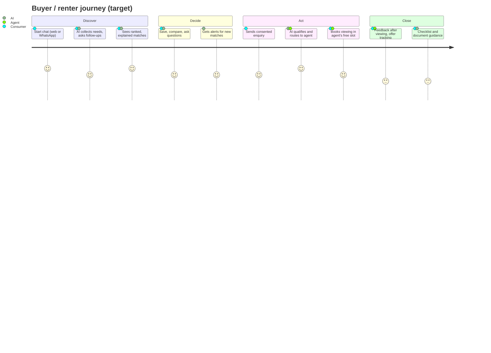

# PRD — AI Real Estate Agent Platform (Master)

| | |
|---|---|
| **Document** | PRD_MASTER.md |
| **Version** | 1.0 (initial) |
| **Date** | 2026-11-21 |
| **Status** | Draft for product and engineering review |
| **Baseline** | `pakpropai` @ `0b574a7` (branch `development`) |
| **Companion documents** | [EXISTING_SYSTEM_ASSESSMENT](EXISTING_SYSTEM_ASSESSMENT.md) · [FEATURE_GAP_ANALYSIS](FEATURE_GAP_ANALYSIS.md) · [TECHNICAL_RECOMMENDATIONS](TECHNICAL_RECOMMENDATIONS.md) · [AI_CAPABILITIES_SPECIFICATION](AI_CAPABILITIES_SPECIFICATION.md) · [API_AND_DATA_REQUIREMENTS](API_AND_DATA_REQUIREMENTS.md) · [MVP_SCOPE](MVP_SCOPE.md) · [PRODUCT_ROADMAP](PRODUCT_ROADMAP.md) · [RISKS_AND_DEPENDENCIES](RISKS_AND_DEPENDENCIES.md) · [PRD_CHANGELOG](PRD_CHANGELOG.md) |

### Conventions

- **Labels:** `[EXISTS]` = verified in code (possibly needing improvement) · `[EXTEND]` = exists, must be extended or redesigned · `[NEW]` = proposed.
- **Priority:** **P0** critical/foundational · **P1** MVP/high value · **P2** growth/optimisation · **P3** advanced/future. Rationale in §C.0.
- **Requirement IDs:** `FR-<MODULE>-<NNN>`; non‑functional `NFR-<AREA>-<NNN>`.
- **Assumption tag:** `ASSUMPTION:` marks statements not derived from the repository that need validation.
- **No market statistics are asserted in this document.** Where market sizing is needed, it is listed as a research task.

---

# Part A — Existing Product Assessment (summary)

The full assessment is in [EXISTING_SYSTEM_ASSESSMENT.md](EXISTING_SYSTEM_ASSESSMENT.md). Key points:

1. **What exists:** a Django modular monolith (26 apps) delivering a **WhatsApp‑first, multi‑tenant AI assistant and CRM for real estate organizations**. It also has trust/verification, token‑payment "Deal Lock", subscriptions, campaigns, analytics, compliance scaffolding and market packs for PK, AE, GB and US.
2. **Strongest assets:** tenancy and white‑labelling, the listing ownership model, the lead routing state machine and CRM, the cost‑aware AI pipeline, observability, and compliance scaffolding.
3. **Weakest assets (which are also the most important for the target product):** the property data model, search and ranking, the recommendation engine, AI orchestration and governance, the consumer channel beyond WhatsApp, and the legality of listing supply (scraping).
4. **Critical defects:** plaintext secrets in DB, scraping in the production path, zero‑token accounting, a per‑org (not per‑user) semantic cache, side‑effect tools without server‑side confirmation, sandbox listings in live search, and a CI pipeline with paths that do not match the repo layout.
5. **Maturity:** ≈ **2/5** for the AI real estate agent product: late prototype / early beta.

**Strategic implication:** **evolve the monolith incrementally. Do not rewrite it.** Redirect effort from breadth (voice, syndication, escrow, regional clusters) to depth in the core loop: *understand needs → find the right properties → explain → connect to a professional → schedule → follow up*.

---

# Part B — Product Strategy

## B.1 Product Vision

> **An AI real estate agent that anyone, anywhere, can talk to in their own language and that gives honest, grounded answers. It understands what people need, finds and explains the right properties, and connects them with accountable professionals. For those professionals it is the workspace that turns conversations into closed deals.**

## B.2 Mission

Make property decisions **faster, better informed and safer** by combining verified listing data, transparent AI reasoning and accountable human professionals.

## B.3 Problem Statement

| Stakeholder | Problem |
|---|---|
| Buyers / renters | Portals are filter‑heavy, noisy, duplicated and often stale or fraudulent. They do not understand lifestyle needs ("near a good school, quiet, short commute"). Comparing options and costs across currencies and markets is hard. |
| Sellers / landlords | Writing good listings, pricing, and filtering serious enquiries takes time. Lead quality is low. |
| Agents / agencies / developers | Leads arrive across WhatsApp, portals and calls. Response time decides conversions. Qualification, follow‑up and reporting are manual. |
| International buyers | Little trusted, cross‑market information, currency friction, and no way to know whether an agent or listing is legitimate. |
| Platform operators | Trust and fraud management, data licensing, and multi‑market compliance. |

## B.4 Market Opportunity (research required)

The platform targets the intersection of **property discovery**, **agent productivity SaaS** and **conversational AI**. This PRD makes **no quantitative market claims**. Required research before investment decisions:

- TAM/SAM/SOM per launch market: number of active agents and agencies, listing volumes, portal pricing, WhatsApp penetration.
- Competitive landscape per market (portals, CRMs, AI assistants).
- Willingness to pay of agencies/developers for AI lead qualification.

## B.5 Positioning

- **For consumers:** *"A knowledgeable, unbiased property assistant that explains its recommendations and never invents facts."*
- **For professionals:** *"An AI teammate that answers every enquiry instantly on WhatsApp and web, qualifies it, and hands you ready‑to‑close leads."*
- **Category:** AI‑first property discovery + professional workspace. **Not** a generic chatbot and **not** a pure listing portal.

## B.6 Value Proposition

| Persona | Core value | Proof point to build |
|---|---|---|
| Buyer/renter | Describe needs in natural language → ranked, explained, de‑duplicated options; honest trade‑offs | Match explanations traceable to listing fields |
| Seller/landlord | AI listing creation, quality score, serious‑lead filtering | Listing quality score; enquiry qualification rate |
| Agent | 24/7 AI first response, qualification, summaries, suggested replies, scheduling | Median first‑response time; qualified‑lead conversion |
| Agency/developer | Branded AI on their own WhatsApp number, team routing, analytics | Leads handled per agent; cost per qualified lead |
| International buyer | Cross‑market discovery with currency and unit conversion and verified professionals | Verified badges; FX‑normalised comparisons |

## B.7 Differentiation

1. **WhatsApp‑native and web‑native AI agent** on the organization's own number (existing asset).
2. **Grounded AI:** every factual claim about a property is traceable to a listing field or a cited source. Estimates are labelled.
3. **Trust layer:** listing verification, professional verification and fraud signals (existing scaffolding).
4. **Global‑ready market packs:** country‑specific units, taxes, documents and conventions as configuration (existing seed).
5. **Neutral recommendations:** paid placement is always labelled and **never** changes the AI match score (see §H).

## B.8 Target Markets

**Recommendation:** validate in **one primary market (Pakistan)** and prepare **one secondary market (UAE)**, while building every foundation globally.

Reasoning (evidence‑based on the repository, not market data):

- Pakistan has the deepest implementation: market pack, units (marla/kanal), tax calculators, document types, Roman‑Urdu handling, local payment gateways, seed data.
- UAE already has a market pack (AED, sqft, DLD fee knowledge, Emirates ID, Title Deed/Oqood document types), Bayut adapter scaffolding, and a regional DB alias.
- `ASSUMPTION:` A PK↔UAE corridor (diaspora investors) makes cross‑border features testable early. Validate with research.
- GB and US packs exist but carry heavier regulatory and data‑licensing burden (property data licensing, fair‑housing rules in the US). Defer them until Phase 5.

## B.9 Business Objectives

| ID | Objective | Horizon |
|---|---|---|
| BO‑1 | Launch a lawful, trustworthy AI discovery and lead‑qualification MVP in the primary market | MVP |
| BO‑2 | Prove agency willingness to pay (paid conversions from trial) | MVP + 1 quarter |
| BO‑3 | Achieve measurable consumer value (repeat usage, enquiry rate) | Phase 2–3 |
| BO‑4 | Expand to a second market using configuration rather than a fork | Phase 5 |
| BO‑5 | Keep AI unit economics within the subscription margin | Continuous |

## B.10 Success Metrics

Targets are **placeholders to be set after a baseline measurement period**. No targets are asserted without data.

| Area | Metric | Definition |
|---|---|---|
| Consumer value | Search‑to‑shortlist rate | % of AI discovery sessions where ≥1 property is saved/shortlisted |
| | Enquiry rate | % of sessions producing a consented enquiry |
| | 30‑day return rate | % of users returning within 30 days |
| AI quality | Criteria extraction accuracy | F1 vs labelled golden set (per language) |
| | Hallucinated attribute rate | % of responses stating a property fact not present in source data (target: ~0; release blocker above threshold) |
| | Tool‑call success rate | % of tool calls with valid args and non‑error result |
| | Escalation appropriateness | Human‑rated |
| Professional value | Median first‑response time | Inbound enquiry → first meaningful reply |
| | Lead qualification rate | % of leads with intent+budget+location+timeline captured |
| | Lead→viewing conversion | |
| Business | Trial→paid conversion | Org level |
| | Net revenue retention | |
| | AI cost per qualified lead | Real token cost (requires fixing TD‑03) |
| Trust | Fraud reports per 1,000 listings; time‑to‑takedown | |
| Reliability | API p95 latency; AI reply p95; webhook processing success | |

## B.11 Global Strategy

**One codebase, one platform, many markets** through a `Market` configuration layer (country, currencies, units, languages, legal disclaimers, document types, tax/fee calculators, listing attribute schema, data sources). Data residency is handled per region **only when a market requires it**. Detail in Part E.

## B.12 Personas and Roles

A **scalable permission model** (policy‑based RBAC with org‑scoped roles) replaces the hardcoded `User.role` checks. See [TECHNICAL_RECOMMENDATIONS §6](TECHNICAL_RECOMMENDATIONS.md#6-authorization-and-rbac).

| Role | Scope | Responsibilities / main workflows | Data visibility | Monetisation |
|---|---|---|---|---|
| **Consumer** (buyer, renter, investor, international buyer, first‑time buyer, commercial seeker) | Self | Discover, chat, save, compare, enquire, schedule viewings, manage preferences and consent | Own data; public listings | Free; optional premium later (P3) |
| **Seller / landlord (private)** | Self + own listings | Create listings (where the market allows private listings), respond to enquiries, view analytics | Own listings and their enquiries | Listing packages / boosts (P2) |
| **Agent (internal)** | Org | Manage assigned leads, listings, viewings, messages; use co‑pilot | Org listings; assigned leads (configurable: team or org) | Seat in agency plan |
| **Freelance / independent broker** | Self (+ partnerships) | Own listings and leads; syndicated listings | Own + partner‑shared | Individual plan |
| **Team / sales manager** | Org team | Assign, monitor, coach; reports | Team's leads and listings | — |
| **Org admin / owner** (agency, developer, property manager) | Org | Members, roles, WhatsApp/AI config, branding, billing, integrations | Whole org | Subscription owner |
| **CRM operator** | Org | Data entry, lead triage | Org leads (no billing) | — |
| **Viewer / analyst** | Org | Read‑only reports | Aggregates | — |
| **Developer (project) org** | Org | Projects, unit inventory, syndication to brokers | Own projects | Developer package (P2) |
| **Property manager / leasing agent** | Org | Rentals, applicants, renewals | Managed units | P3 module |
| **Super admin** | Platform | Everything; break‑glass | All (audited) | — |
| **Country / regional admin** `[NEW]` | Market | Market config, local moderation, local partners | Market‑scoped | — |
| **Moderator** | Platform/market | Listing and user moderation, fraud queue | Content + reports | — |
| **Support agent** | Platform | Account help, impersonation with consent (audited) | Scoped tickets | — |
| **Compliance officer** | Platform | DSARs, AML, audits | Compliance records | — |
| **AI operations admin** | Platform | Prompts, models, evals, tool policies, cost | AI telemetry (PII‑redacted) | — |
| **Billing admin** | Platform | Plans, invoices, refunds | Billing data | — |

Existing mapping: `User.Role` (client/agent/developer/admin), `User.PlatformRole` (6 platform sub‑roles), `OrganizationMembership.Role` (8 org roles). **Country/regional admin and moderator are new.**

## B.13 User Journeys (summary)

Full journeys are in Part C modules C.7 and C.8.

---

# Part C — Future Product Requirements

## C.0 Prioritisation rationale

| Priority | Meaning | Selection criteria |
|---|---|---|
| **P0** | Foundational, or a blocker to a safe launch | Security/legal blockers, data model foundations, defects that corrupt metrics or leak data |
| **P1** | MVP: needed for the core value loop in one market | Direct user value in discovery → enquiry → viewing, with data available and feasible AI |
| **P2** | Growth/optimisation after product‑market signal | Depends on usage data, partner data or P1 adoption |
| **P3** | Advanced/future | Regulatory complexity, licensed datasets, or a speculative return |

A consolidated priority list is in [FEATURE_GAP_ANALYSIS §3](FEATURE_GAP_ANALYSIS.md#3-feature-priority-register).

Each module below follows the requested structure. Shared NFRs (latency, security, audit) are in Part D and are not repeated per module.

---

## C.1 AI Real Estate Agent (conversational core) — **P0/P1** `[EXTEND]`

**Overview.** One agent runtime serves web/app chat, WhatsApp and (later) voice, with channel‑specific formatting. It uses an explicit, platform‑controlled tool loop and structured intermediate outputs.

**Business purpose.** The primary differentiator. It converts intent into qualified, consented enquiries.

**Target users.** Consumers (all types), sellers/landlords; professionals through the co‑pilot.

**User stories**
- As a renter, I describe my needs in my own words and get relevant options without filling in forms.
- As a buyer, I can ask "why this one?" and get reasons tied to the listing's facts.
- As a user, I can say "show me cheaper ones closer to the metro" and the search updates.
- As a user, I can see and edit what the assistant remembers about me, or delete it.
- As a user, I'm told clearly when the assistant doesn't know something, and I'm offered a human.

**Functional requirements**

| ID | Requirement | Priority |
|---|---|---|
| FR‑AI‑001 | Provide a channel‑agnostic conversation API (`POST /api/v1/conversations/{id}/messages`, streaming via SSE/WebSocket) for web/app; WhatsApp and voice adapters call the same runtime | P1 |
| FR‑AI‑002 | Persist conversations and messages durably in Postgres (not only Redis), with retention policy per market | P0 |
| FR‑AI‑003 | Extract search criteria into the validated `SearchCriteria` schema (see AI spec §4); unknown or ambiguous fields trigger a clarifying question (max 1–2 per turn) | P1 |
| FR‑AI‑004 | Maintain session state (`active_criteria`, `shortlist`, `last_results`) separately from chat history | P1 |
| FR‑AI‑005 | Call tools through a platform‑controlled loop with a tool registry, per‑tool permission, argument validation, rate limits and audit logs | P0 |
| FR‑AI‑006 | Tools with side effects (create listing, create enquiry, book viewing, initiate payment) require **explicit user confirmation** captured server‑side (confirmation token) before execution | P0 |
| FR‑AI‑007 | Responses about specific properties must cite the property IDs used; the grounding checker validates price, size, rooms, location and amenities against source data before sending | P0 |
| FR‑AI‑008 | Long‑term preference profile, stored only with consent, viewable/editable/deletable by the user (FR‑REC‑002) | P1 |
| FR‑AI‑009 | Multilingual: respond in the user's language. Launch languages per market config (PK: English, Urdu, Roman Urdu; AE: English, Arabic) | P1 |
| FR‑AI‑010 | Human escalation: user request, low confidence, sensitive topics (legal/financial/discrimination), repeated failure → route to org queue/agent with summary | P1 |
| FR‑AI‑011 | Channel formatting adapters (WhatsApp markdown subset, web rich cards, voice SSML) | P1 |
| FR‑AI‑012 | Voice interaction reuses the runtime (existing Twilio prototype) | P3 |
| FR‑AI‑013 | Seller/landlord mode: conversational listing intake drafting a listing for review (never auto‑publish) | P2 |
| FR‑AI‑014 | Investor mode delegates numbers to the deterministic calculator (C.10) | P2 |

**AI requirements.** See [AI_CAPABILITIES_SPECIFICATION](AI_CAPABILITIES_SPECIFICATION.md) §2–§8.

**Business rules**
- The AI never states listing facts that are not in the source data. Unknown facts are answered as "not specified by the lister".
- The AI never provides legal, tax, immigration or financial advice. It gives general information with a market‑specific disclaimer and offers a professional.
- The AI does not use or infer protected characteristics (e.g. religion, ethnicity, family status where protected) to filter or steer. Requests such as "safe family‑friendly area" are answered only with objective, sourced indicators and a neutral framing (market‑specific policy; legal review required).
- Paid placement never changes match scores.

**API requirements.** `conversations`, `messages` (stream), `conversations/{id}/state`, `preferences`, `confirmations/{token}`. See [API_AND_DATA_REQUIREMENTS §2.1](API_AND_DATA_REQUIREMENTS.md).

**Data requirements.** `Conversation`, `Message`, `ConversationState`, `ToolInvocation`, `PreferenceProfile`, `Consent` (purpose `ai_memory`), `PromptVersion` reference per message.

**Permissions.** Consumer: own conversations. Org agents: conversations routed to their org (WhatsApp sessions under their number, or enquiries). AI ops: redacted transcripts only.

**Edge cases.** Mixed languages in one message; currency or unit not stated (infer from market, then confirm); conflicting constraints ("3 bed under X" with no inventory) → explain the trade‑off and suggest relaxations; user pastes a listing URL from another portal → do not scrape; ask for details or treat it as a reference only.

**Failure scenarios.** LLM provider down → failover model; if all fail, deterministic search fallback with templated results. Tool error → apologise, retry once, offer human. Guardrail block → safe reply, security trace. Budget exhausted → degrade to deterministic routes and hand off to a human.

**Acceptance criteria**
1. On the golden set (≥300 labelled utterances per launch language), criteria extraction F1 ≥ the agreed threshold, and **0 critical hallucinations** (stated property facts absent from source) in the release eval.
2. No side‑effect tool executes without a stored confirmation record (verified by tests).
3. Every assistant message is linked to `prompt_version`, `model`, `tokens_in/out`, `latency_ms`, and tool calls.
4. Web chat p95 time‑to‑first‑token ≤ 2.5 s and full reply ≤ 8 s under nominal load (`ASSUMPTION:` targets to validate).
5. Users can export and delete their AI memory, and deletion propagates within the SLA.

**Dependencies.** C.2 search, C.3 listing schema, AI governance (Part F), consent (Part E), observability.

---

## C.2 Intelligent Property Discovery & Search — **P1** `[EXTEND]`

**Overview.** Hybrid search: deterministic structured filters + geospatial + full‑text, with optional semantic retrieval for lifestyle descriptors. Ranking is configurable and explainable.

**Business purpose.** Relevance is the product.

**User stories**
- As a user, I search with filters, on a map, or by chatting, and get consistent results across all three.
- As a user, I search within a commute or a radius of a place.
- As a user, I filter by purpose (buy/rent), beds/baths, size, price in my currency, amenities, furnishing, pets and accessibility.

**Functional requirements**

| ID | Requirement | Priority |
|---|---|---|
| FR‑SRCH‑001 | Single `SearchService.execute(SearchCriteria)` used by REST, AI tools and alerts | P1 |
| FR‑SRCH‑002 | Filters: market/country, location (hierarchy IDs), purpose, property category/subtype, price range (+currency), beds, baths, size range (canonical m² with display units), furnishing, completion status, amenities (taxonomy IDs), pets, accessibility, listing age, verified‑only | P1 |
| FR‑SRCH‑003 | Geospatial: radius around point, bounding box (map viewport), polygon; distance to POI (requires POI data, P2) | P1 (radius/bbox), P2 (POI) |
| FR‑SRCH‑004 | Full‑text over title/description/location with stored `tsvector` + GIN; trigram for fuzzy location names | P1 |
| FR‑SRCH‑005 | Semantic retrieval (embeddings) for descriptive needs ("bright, quiet, modern"), blended into ranking only after filters | P2 |
| FR‑SRCH‑006 | Ranking = weighted, configurable score (filter match, preference fit, freshness, quality score, verification) with a per‑result `explanation[]`; paid boosts are separate and labelled | P1 |
| FR‑SRCH‑007 | Facets/counts for filters; cursor pagination; stable sort | P1 |
| FR‑SRCH‑008 | Exclude sandbox, expired, unpublished, suspended listings; enforce market visibility | **P0** |
| FR‑SRCH‑009 | Currency conversion for display and range filtering using daily FX snapshots (labelled "approximate") | P1 (display), P2 (filter across currencies) |
| FR‑SRCH‑010 | Commute‑time search | P3 (needs routing API) |
| FR‑SRCH‑011 | Remove portal scraping from the search path; external listings only via licensed feeds | **P0** |

**NL→structured example** (the requirement's own example):

> "I want a modern 3‑bedroom apartment near public transportation, with a gym, in a safe family‑friendly neighborhood, under my budget."

| Phrase | Field | Handling |
|---|---|---|
| "3‑bedroom" | `bedrooms.min = 3` | Deterministic |
| "apartment" | `property_subtype = apartment` | Taxonomy |
| "with a gym" | `amenities ⊇ {gym}` | Taxonomy (hard filter unless the user relaxes it) |
| "modern" | `soft_preferences.style = modern` | Semantic/keyword boost only, never a hard filter |
| "near public transportation" | `proximity: transit ≤ X m` | Requires POI data (P2). Until then: ask the user to name a station/area, or say the data is unavailable |
| "safe family‑friendly neighborhood" | **Not a filter** | Policy: no subjective safety or "family" claims. Offer sourced indicators where licensed (P3) and suggest the user consult local sources. Fair‑housing review required for markets such as the US |
| "under my budget" | `price.max = profile.budget_max` | From the preference profile; if missing → ask |
| purpose missing | `purpose` | Ask: "Buying or renting?" |

**Acceptance criteria.** The same criteria produce identical result sets via REST and the AI tool. p95 search latency ≤ 400 ms at 100k active listings with indexes (`ASSUMPTION`). Explanations reference only fields present in the listing.

**Dependencies.** C.3 schema, location hierarchy, PostGIS (TR‑05), FX service.

---

## C.3 Property Listings & Management — **P0/P1** `[EXTEND]`

**Overview.** A flexible global listing schema with a core typed model, a per‑market attribute schema (JSON Schema validated), a lifecycle with moderation, and rich media.

**Functional requirements**

| ID | Requirement | Priority |
|---|---|---|
| FR‑LST‑001 | Core fields: purpose (sale, rent_long, rent_short, lease_commercial), category (residential, commercial, industrial, land, hospitality), subtype taxonomy, bedrooms, bathrooms, size (built/plot) with canonical m², floor/total floors, year built, furnishing, completion status, parking | **P0** |
| FR‑LST‑002 | Pricing: amount, currency, price type (total, per month, per year, per m²), negotiable, service charges, deposit, price on request; **price history** table | P0 (core), P1 (history) |
| FR‑LST‑003 | Location: structured address, location hierarchy FK, geo point (PostGIS), location precision (exact/approximate) and privacy masking for private sellers | P0 |
| FR‑LST‑004 | Market attribute schema: `Market.listing_schema` validates `attributes` JSON (e.g. PK: marla/kanal, possession; AE: permit/RERA number; GB: EPC rating, tenure) | P1 |
| FR‑LST‑005 | Lifecycle: `draft → pending_review → published → under_offer → sold/let → expired → archived`, plus `suspended`; transitions enforced in a service with audit | P0 |
| FR‑LST‑006 | Expiry and renewal (market‑configurable duration; reminders) | P1 |
| FR‑LST‑007 | Media: images (ordered, alt text, AI tags), video links, virtual tour URL, floor plans, documents (private by default); EXIF/GPS stripping, content‑type sniffing, malware scan for documents | P1 (images hardened), P2 (video/tour/floor plans) |
| FR‑LST‑008 | Ownership and attribution: keep `listing_owner_type` constraint `[EXISTS]`; add `listing_agent`, `agency`, and `mandate/authority` record | P1 |
| FR‑LST‑009 | Moderation queue: automated checks (required fields, price outliers vs benchmarks, duplicate candidates, prohibited content) → human review for flagged items | P1 |
| FR‑LST‑010 | Duplicate detection: persistent fingerprint (geo cell + size + price band + image perceptual hash) with merge/cluster | P2 |
| FR‑LST‑011 | Verification badges: lister verified, authority verified, document reviewed (existing verification queue `[EXTEND]`) | P1 (lister), P2 (authority) |
| FR‑LST‑012 | Listing analytics: impressions, detail views, saves, enquiries, conversion | P1 |
| FR‑LST‑013 | Featured/boosted listings (labelled) | P2 |
| FR‑LST‑014 | Projects/developments with unit inventory (off‑plan) | P2 |
| FR‑LST‑015 | Short‑term rental specifics (availability calendar, nightly price) | P3 |
| FR‑LST‑016 | Rename `area_marla` → `size_value` via expand/contract migration; keep the API alias for one version | P0 |

**Business rules.** A listing cannot be published without purpose, category, price (or price‑on‑request), location at locality level, and at least one image (market‑configurable). Private seller exact addresses are hidden until the seller chooses to share.

**Acceptance criteria.** All lifecycle transitions are covered by tests. Invalid transitions return 409. Market schema validation errors return field‑level 400s. Migrating existing records preserves data, with a backfill report.

**Dependencies.** Location hierarchy, Market config, media pipeline.

---

## C.4 AI Property Matching & Recommendations — **P1 (rules) / P2 (learned)** `[EXTEND]`

| ID | Requirement | Priority |
|---|---|---|
| FR‑REC‑001 | Match score 0–100 = Σ wᵢ·fᵢ over hard‑filter pass + soft factors (price fit, location fit, size fit, amenities overlap, freshness, quality, verification); weights configurable per market in admin | P1 |
| FR‑REC‑002 | Preference profile: explicit (stated) + implicit (saves, views, dismissals), each with source and timestamp; user‑visible and editable; consent‑gated | P1 |
| FR‑REC‑003 | Explanations: top 3 positive factors + top trade‑off, generated from the factor breakdown (template or LLM paraphrase constrained to factors) | P1 |
| FR‑REC‑004 | Favourites, saved searches, search history | P1 |
| FR‑REC‑005 | Similar listings (existing `similar_to` `[EXTEND]` with geo + attributes) | P1 |
| FR‑REC‑006 | Behavioural re‑ranking (learning‑to‑rank) once ≥ N interactions exist (threshold set by data science) with A/B evaluation | P2 |
| FR‑REC‑007 | Investment suitability factor (yield estimate where rent data exists) | P3 |

**Evolution path:** rule‑based (existing `recommend_for_lead` → refactored) → logged features and outcomes → offline learning‑to‑rank → online A/B. Every stage keeps the factor explanation.

**Acceptance.** For a fixed profile and dataset, scores are deterministic and reproducible. The explanation factors sum to the score breakdown.

---

## C.5 Property Comparison & Intelligence — **P1 (basic) / P2 (AI report)** `[EXTEND]`

| ID | Requirement | Priority |
|---|---|---|
| FR‑CMP‑001 | Compare 2–4 listings for consumers and professionals (the existing endpoint is agent‑only) | P1 |
| FR‑CMP‑002 | Normalised table: price (and FX‑converted), price per m², size, rooms, amenities diff, location, verification, listing age, preference match per factor | P1 |
| FR‑CMP‑003 | AI comparison narrative constrained to the normalised table; every claim maps to a cell; unknowns flagged | P2 |
| FR‑CMP‑004 | Estimated running costs where market rules exist (taxes/fees from market calculators) clearly labelled as estimates | P2 |

---

## C.6 AI Property Valuation & Market Analysis — **P2/P3** `[EXTEND]`

**Position:** the platform provides **indicative price context, not valuations**. Existing `PropertyAudit` + `AuditBenchmark` are reframed as an "Indicative Price Context" report.

| ID | Requirement | Priority |
|---|---|---|
| FR‑VAL‑001 | Price‑per‑m² distribution of comparable active listings (same locality/subtype/size band) with sample size; hidden when N < threshold | P2 |
| FR‑VAL‑002 | Data provenance labels on every figure: `listing_asking_price` · `third_party_estimate (source)` · `admin_benchmark (date, author)` · `ai_commentary` | P0 for existing audit reports (Phase 0); P2 for new reports |
| FR‑VAL‑003 | Confidence indicator (sample size, dispersion, data age) | P2 |
| FR‑VAL‑004 | Mandatory disclaimer per market: "not a valuation or appraisal; consult a licensed valuer" | **P0** (apply to existing audit PDFs) |
| FR‑VAL‑005 | Transaction‑based trends, rental estimates, appreciation | P3 (requires licensed transaction data) |

Current `market-trends` (average asking price by listing creation month) must be labelled "asking‑price trend of listings on this platform".

---

## C.7 Buyer & Renter Journey — **P1** `[EXTEND]`

| Step | Platform responsibility | MVP? | External dependency |
|---|---|---|---|
| 1 Onboarding | Phone/OTP `[EXISTS]`, add email/social (P2) | ✔ | SMS/WhatsApp OTP |
| 2 Profile setup | Market, language, currency, units, consents | ✔ | — |
| 3 Requirements | AI conversation + form | ✔ | — |
| 4 AI conversation | C.1 | ✔ | LLM |
| 5 Discovery | C.2 | ✔ | Maps tiles (P1), POI (P2) |
| 6 Shortlist | Favourites, notes | ✔ | — |
| 7 Comparison | C.5 basic | ✔ | — |
| 8 Enquiry | Consented enquiry → Lead `[EXTEND]` | ✔ | — |
| 9 Contact | Agent/owner via in‑app thread or WhatsApp | ✔ (WhatsApp + email notification) | WhatsApp, email |
| 10 Viewing scheduling | C.13 | ✔ (basic) | Calendar sync P2 |
| 11 Viewing management | Status, reminders, feedback | ✔ | — |
| 12 Negotiation assistance | Checklists, general info only | ✘ (P2) | — |
| 13 Offer tracking | `Offer` entity, status | ✘ (P2) | — |
| 14 Documents & checklist | Market checklist templates | ✘ (P2) | Legal review of templates |
| 15 Transaction progress | Milestones (manual updates) | ✘ (P3) | Conveyancers, banks |
| 16 Post‑transaction | Moving/services marketplace | ✘ (P3) | Partners |

**Not built in‑house:** conveyancing, legal review, mortgage underwriting, escrow. These are partner integrations only, after legal review.

## C.8 Seller & Landlord Journey — **P1/P2**

| Step | Requirement | Priority |
|---|---|---|
| Onboarding & authority | Identity (existing IDV `[EXTEND]`), mandate/ownership declaration; document upload for review | P1 (declaration), P2 (documents) |
| Listing creation | Form + AI intake (C.9) → draft | P1 |
| Quality score | Completeness, photo count/quality, description quality, price sanity | P1 |
| Pricing guidance | Indicative context (C.6) | P2 |
| Publish & moderation | C.3 lifecycle | P1 |
| Leads & enquiries | Inbox, AI pre‑qualification | P1 |
| Viewings | C.13 | P1 |
| Applicant screening support (rentals) | Structured application form; **no automated accept/reject decisions**; screening via licensed providers only | P3 |
| Offers | Offer register | P2 |
| Analytics | Listing performance (FR‑LST‑012) | P1 |

## C.9 AI Listing Assistant — **P1** `[NEW]`

| ID | Requirement | Priority |
|---|---|---|
| FR‑LAI‑001 | Generate title and description **only from structured fields + seller notes**; output marks any sentence lacking a source field for removal | P1 |
| FR‑LAI‑002 | Missing‑information detection against the market schema ("add bathrooms count, parking") | P1 |
| FR‑LAI‑003 | Attribute extraction from free text/brochure into structured fields as **suggestions** requiring confirmation | P1 |
| FR‑LAI‑004 | Image tagging (room type, quality warnings); no inference of features not visible | P2 |
| FR‑LAI‑005 | Translations to market languages, marked machine‑translated | P2 |
| FR‑LAI‑006 | SEO meta and social post drafts | P2 |
| FR‑LAI‑007 | Performance insights ("listings with floor plans in this area get more enquiries"; only from platform data with N threshold) | P3 |

**Safeguards.** Fabrication check: generated text is re‑parsed and numbers/amenities are compared with the fields; mismatches block saving. Superlatives and claims about schools, safety or investment returns are disallowed by policy. A human always approves before publishing.

## C.10 Real Estate Investment Assistant — **P2** `[EXTEND]`

| ID | Requirement | Priority |
|---|---|---|
| FR‑INV‑001 | Deterministic calculator service: gross yield, net yield, cash flow, cash‑on‑cash, simple ROI scenarios, vacancy and expense assumptions; inputs and formulas shown | P2 |
| FR‑INV‑002 | Assumptions panel with sources (user input, platform median rent with N, market default) | P2 |
| FR‑INV‑003 | AI commentary separate from numbers, labelled "general information, not financial advice" | P2 |
| FR‑INV‑004 | Market tax/fee calculators reused from `apps/markets/calculators` `[EXISTS]` | P2 |
| FR‑INV‑005 | Risk notes from objective data only (vacancy assumption sensitivity, currency exposure) | P3 |

## C.11 Agent, Broker & Agency CRM — **P1** `[EXTEND]`

Most entities already exist (Lead, LeadActivity, Appointment, ConversationMessage, LeadScoreHistory, CRMContact).

| ID | Requirement | Priority |
|---|---|---|
| FR‑CRM‑001 | Unified contact (person) ↔ multiple leads (requirements) model; merge `CRMContact`/`ClientProfile`/`Lead.user` semantics | P1 |
| FR‑CRM‑002 | Configurable pipeline stages per org (default: new → contacted → qualified → viewing → offer → won/lost) replacing fixed `Status`; keep `routing_state` | P1 |
| FR‑CRM‑003 | Lead sources incl. web enquiry, WhatsApp, portal feed, referral, API | P1 |
| FR‑CRM‑004 | Tasks and follow‑ups with due dates and reminders | P1 |
| FR‑CRM‑005 | Lead scoring: transparent factors (existing `score_factors` `[EXTEND]`), AI explanation | P1 |
| FR‑CRM‑006 | AI: conversation summary `[EXISTS]`, suggested replies `[EXISTS]`, next‑best‑action, buyer‑intent signals with evidence quotes | P1 (summary/replies), P2 (NBA) |
| FR‑CRM‑007 | Team management, assignment rules (round‑robin, area, language, load) `[EXTEND auto‑assign]` | P1 |
| FR‑CRM‑008 | Agent performance: response time, conversion, viewings (existing reports `[EXTEND]`) | P1 |
| FR‑CRM‑009 | Offer tracking | P2 |
| FR‑CRM‑010 | CRM import/export and external CRM sync (existing API keys `[EXTEND]`) | P2 |

## C.12 Communication & Collaboration — **P1/P2** `[EXTEND]`

| ID | Requirement | Priority |
|---|---|---|
| FR‑COM‑001 | In‑app enquiry threads (consumer ↔ agent/owner) with attachments; masked contact details until both opt in | P1 |
| FR‑COM‑002 | WhatsApp remains first‑class `[EXISTS]`; threads link to the same Lead | P1 |
| FR‑COM‑003 | Email notifications via a transactional provider | P1 |
| FR‑COM‑004 | Push notifications (FCM/APNs) | P2 |
| FR‑COM‑005 | SMS fallback for OTP where WhatsApp is unavailable | P2 |
| FR‑COM‑006 | AI‑assisted replies (agent side) `[EXISTS]` | P1 |
| FR‑COM‑007 | Spam/abuse: rate limits, report/block, link scanning, keyword risk flags | P1 |
| FR‑COM‑008 | Auditability: immutable message log, retention per market | P1 |
| FR‑COM‑009 | Consolidate `ConversationMessage` and `WhatsAppMessage` into a single `Message` with channel | P1 |

**Architecture.** A `Communications` module with a channel adapter interface (whatsapp, email, push, sms, in_app); outbox pattern for delivery; preferences and quiet hours per user.

## C.13 Appointment & Viewing Management — **P1** `[EXTEND]`

| ID | Requirement | Priority |
|---|---|---|
| FR‑APT‑001 | Agent availability as weekly rules + exceptions, stored in agent's time zone | P1 |
| FR‑APT‑002 | Slot search and booking by consumers/AI (with confirmation) | P1 |
| FR‑APT‑003 | Time‑zone aware storage (UTC) and display (participant TZ); fixes the PKT‑centric settings | P1 |
| FR‑APT‑004 | Statuses `[EXISTS]` + participants (multiple), location/virtual link | P1 |
| FR‑APT‑005 | Reminders (existing 15‑min job `[EXTEND]`) by user channel preference | P1 |
| FR‑APT‑006 | Post‑viewing feedback (both sides) feeding recommendations and the CRM | P1 |
| FR‑APT‑007 | Calendar sync (Google, Microsoft) and ICS invites | P2 |

## C.14 Global Property Marketplace — **P0 (foundations) / P2+ (expansion)**

Defined in Part E. Key requirement: a `Market` entity replaces scattered defaults (`PKR`, `PK`, `marla`, `Asia/Karachi`, city maps).

## C.15 International Property & Relocation — **P3** `[NEW]`

Feasible without regulated advice: cross‑market search with FX and unit normalisation, international buyer profile (home country, currency, target markets), country fact sheets (curated, sourced, dated), relocation checklists (generic, legally reviewed), connections to verified international‑facing agents. **Out of scope:** immigration, visa, tax or legal advice.

## C.16 Additional modules evaluated

| Module | Decision | Priority | Notes |
|---|---|---|---|
| AI Property Concierge (proactive) | Build on alerts + preference profile | P2 | Opt‑in only; frequency caps |
| AI Neighbourhood Assistant | Only with licensed/open sourced data, cited and dated | P3 | Existing `NeighbourhoodZone` model is a seed |
| Fraud & listing verification | Extend existing verification/fraud | P1 (rules + queue), P2 (ML) | Price outliers, duplicate images, phone reuse, blacklist |
| Document intelligence | Extend DocumentScan with a real OCR backend; human review | P2 | Never auto‑certify ownership |
| Smart alerts / saved search automation | Build | **P1** | Core retention loop |
| AI voice agent | Keep prototype behind a flag | P3 | Telephony costs, consent and recording laws |
| Knowledge assistant (RAG) | Market knowledge + org FAQs | P2 | Replaces static prompt blocks |
| Owner dashboard | Listing analytics | P1 | |
| Agent workspace | CRM + co‑pilot + inbox | P1 | |
| Agency management | Teams, branches, roles | P1 (teams), P2 (branches) | |
| Marketplace services (mortgage, insurance, movers, inspections, legal) | Partner directory + referral tracking | P3 | Referral disclosure rules |
| Subscription & monetisation | Extend billing | P1 (plans), P2 (usage metering) | |
| AI usage management | Fix accounting; quotas per plan | **P0** (accounting), P1 (quotas) | |
| Admin & operations platform | Extend | P1 | See Part G |
| Deal Lock / escrow | **Freeze behind feature flag; legal review** | P3 | Regulated activity risk |
| Syndication marketplace / commission ledger | Freeze; revisit with developer customers | P3 | |
| Campaigns (WhatsApp broadcast) | Keep; enforce opt‑in and template policy | P2 | |
| Regional DB clusters | Defer until a contract requires residency | P3 | Keep router code |
| Fine‑tuning dataset curation | Defer | P3 | Prompting + RAG first |

---

# Part D — Technical Requirements (summary)

Full detail is in [TECHNICAL_RECOMMENDATIONS.md](TECHNICAL_RECOMMENDATIONS.md).

| # | Topic | Requirement summary |
|---|---|---|
| D1 | Architecture | Keep the **Django modular monolith**. Formalise ~12 bounded contexts and enforce import rules. No microservices before clear scaling or team triggers. |
| D2 | Diagram | See TECHNICAL_RECOMMENDATIONS §2 |
| D3 | Domain boundaries | Identity & Access · Tenancy/Orgs · Markets & Localisation · Listings · Search & Discovery · Conversation & AI · CRM · Communications · Scheduling · Trust & Verification · Billing · Compliance & Privacy · Analytics · Platform Ops |
| D4 | Database | PostgreSQL remains the system of record; add **PostGIS** and **pgvector** extensions; GIN/trigram indexes; outbox table |
| D5 | ERD | See API_AND_DATA_REQUIREMENTS §3 |
| D6 | API standards | OpenAPI 3.1 generated schema, consistent error envelope, cursor pagination, idempotency keys, UUIDs everywhere, ISO formats |
| D7 | Versioning | URL major version (`/api/v1`); additive changes only; deprecation headers; v2 only for breaking changes |
| D8 | AI architecture | Provider abstraction, explicit tool loop, prompt registry, structured outputs, eval gating (Part F) |
| D9 | Search | Postgres hybrid first; dedicated engine (OpenSearch/Typesense/Meilisearch) only past defined triggers |
| D10 | Geospatial | PostGIS geography points, GiST indexes, location hierarchy with polygons where available |
| D11 | Events/queues | Transactional outbox → Celery; named queues per workload (`ai`, `notifications`, `media`, `sync`, `default`) |
| D12 | Caching | Redis: per‑user conversation state, search result cache keyed by criteria hash + market, rate limits; semantic cache restricted to non‑personal FAQ intents |
| D13 | Storage | Object storage behind Django storages; private bucket for documents with signed URLs; CDN for public images |
| D14 | Authentication | Keep phone OTP + JWT; add email/password, OAuth (Google/Apple), TOTP MFA for staff and org admins, device/session management |
| D15 | Authorization | Policy‑based RBAC (permissions → roles → org/market scope), object‑level policies, single source in `access` module |
| D16 | Security | Field‑level encryption for secrets and national IDs (KMS‑managed keys); upload scanning; secret rotation; dependency scanning |
| D17 | Observability | Existing stack + AI traces (prompt version, tokens, cost, tool calls) and SLOs |
| D18 | Scalability | Stateless web; horizontal workers; read replica when needed; partition high‑volume logs |
| D19 | Resilience | LLM failover, idempotent tasks, DLQ for failed deliveries, backups with tested restore |
| D20 | Deployment | Containers on ECS (as CI targets) or equivalent; infrastructure as code; staging parity |
| D21 | CI/CD | Fix paths; migration checks; test + eval gates; image scanning; staged deploys |
| D22 | Testing | Unit, API contract, integration (DB/Redis), AI eval suites, load, security; coverage targets per module |

**Key NFRs**

| ID | NFR | Target (`ASSUMPTION`, validate in Phase 0) |
|---|---|---|
| NFR‑PERF‑001 | REST p95 (non‑AI) | ≤ 300 ms |
| NFR‑PERF‑002 | Search p95 | ≤ 400 ms at 100k listings |
| NFR‑PERF‑003 | AI first token p95 (web) | ≤ 2.5 s |
| NFR‑AVL‑001 | API availability | 99.5 % MVP → 99.9 % Phase 4 |
| NFR‑SEC‑001 | Secrets at rest | 100 % encrypted; zero plaintext secrets in DB |
| NFR‑PRIV‑001 | DSAR fulfilment | Within the legal deadline of each market (legal to confirm) |
| NFR‑COST‑001 | AI cost per qualified lead | Tracked from Phase 0; target set after baseline |

---

# Part E — Global Requirements

| # | Topic | Requirements |
|---|---|---|
| E1 | Multi‑country | `Market` entity (ISO country, status `hidden/beta/live`, default currency, supported currencies, languages, units, date/number formats, time zones, listing schema, required disclaimers, document types, tax/fee calculators, data sources, AI policy overrides). Users, orgs, listings reference a market. |
| E2 | Multi‑currency | Store amount + ISO currency; daily FX snapshots table (source, timestamp); convert only for display/filtering with an "approximate" label; never mutate stored prices; billing in each org's billing currency. |
| E3 | Localisation | Django i18n for API messages; translatable taxonomy labels (amenities, subtypes); RTL support flag for clients; locale‑aware formatting (lakh/crore for PK display) as **presentation config**, not logic. |
| E4 | Multilingual AI | Language detection per message; response in user language; per‑language eval sets; translation of listing content marked machine‑translated; no language‑specific logic hardcoded in Python (current Roman‑Urdu keyword lists move into market packs). |
| E5 | Regional config | Market packs as versioned data + plugin code (`apps/markets/<cc>`), loaded via registry `[EXISTS → EXTEND]`. |
| E6 | Market differences | Listing schema per market; rental conventions (advance rent, deposits, cheques in AE); agent licensing fields (e.g. RERA/BRN in Dubai); mandatory listing permit numbers where required. |
| E7 | Time zones | UTC storage; `TIME_ZONE='UTC'` for the server with per‑user/agent/market TZ; Celery schedules defined in UTC; existing PKT schedules migrated. |
| E8 | Units | Canonical m² storage; display units per market/user; supported units extend `_SQM_FACTORS` `[EXISTS]`. |
| E9 | International privacy | Consent per purpose; data map per entity; residency only when required (router `[EXISTS]`); transfer mechanisms reviewed by counsel. |
| E10 | Compliance | Per‑market legal checklist (privacy law, consumer protection, real estate advertising rules, AML obligations for agents, anti‑discrimination/fair housing, payments licensing). **Specialist legal review required for every launch market. No universal compliance is claimed.** |

---

# Part F — AI Requirements (summary)

Full specification is in [AI_CAPABILITIES_SPECIFICATION.md](AI_CAPABILITIES_SPECIFICATION.md).

| # | Topic | Summary | Priority |
|---|---|---|---|
| F1 | Capabilities | Discovery agent, listing assistant, CRM co‑pilot, knowledge Q&A, investment commentary, document extraction | P1–P2 |
| F2 | Workflows | Single agent with a mode router (not multi‑agent) | P1 |
| F3 | Tools | Registry with schemas, permissions, side‑effect class, confirmation policy | P0 |
| F4 | RAG | pgvector over market knowledge, org FAQs, help content; listing retrieval via SearchService (not vector‑only) | P2 |
| F5 | Memory | Short‑term window, session state, consented long‑term profile, summaries | P1 |
| F6 | AI search | NL → `SearchCriteria` structured output → deterministic search | P1 |
| F7 | Recommendations | Explainable factor scoring | P1 |
| F8 | Listing assistant | Field‑grounded generation with a fabrication check | P1 |
| F9 | Investment assistant | Calculator + labelled commentary | P2 |
| F10 | Document intelligence | OCR backend + LLM extraction + human review | P2 |
| F11 | Evaluation | Golden sets, CI gating, online feedback | P0 (harness), P1 (gating) |
| F12 | Safety | Layered guardrails, indirect injection defences, PII redaction, fairness policy | P0 |
| F13 | Observability | Per‑call traces and cost | P0 |
| F14 | Cost | Real token accounting, quotas per plan, model tiering, caching for non‑personal content | P0 |

---

# Part G — Operational Requirements

| # | Area | Requirements | Priority |
|---|---|---|---|
| G1 | Admin panel | Role‑scoped admin APIs (not only Django admin) for users, orgs, listings, markets, AI config, moderation, billing | P1 |
| G2 | Moderation | Queues for listings, users, messages and reports; SLA timers; reason codes; appeals | P1 |
| G3 | Customer support | Ticket linkage, support role with audited, consented impersonation, conversation lookup with PII masking | P2 |
| G4 | User management | Suspend/ban, KYC status, consent view, DSAR tools `[EXTEND compliance]` | P1 |
| G5 | Listing management | Bulk actions, expiry management, duplicate clusters | P1 |
| G6 | Agency management | Verify orgs/agents (existing approve/reject `[EXISTS]`), licence fields per market | P1 |
| G7 | AI management | Prompt versions, model routing, tool enable/disable per market/org, eval dashboards, cost dashboards, kill switch | P1 |
| G8 | Usage analytics | Product analytics events (privacy‑respecting) and funnels `[EXTEND reports]` | P1 |
| G9 | Subscription management | Plans as data (not enums), entitlements, usage metering, invoices, dunning | P1 (plans as data), P2 (metering) |
| G10 | Reporting | Existing reports `[EXISTS]` + scheduled exports | P2 |
| G11 | Audit trails | Unified audit log for admin and sensitive actions (consolidate `core.AuditLog`, `security.ApiSecurityEvent`) | P1 |
| G12 | Incident management | Runbooks, on‑call, status page, AI incident procedure (harmful output, data leak) | P1 |

---

# Part H — Business Requirements

## H.1 Monetisation principles

1. Consumers can always discover and chat for free.
2. **Paid placement is labelled and never changes AI match scores or explanations.**
3. Leads are sold or shared **only with explicit consumer consent** to contact a named professional.
4. AI usage costs are covered by plan entitlements, with transparent overage.

## H.2 Revenue streams and phasing

| Stream | Description | Phase | Notes |
|---|---|---|---|
| Agency/agent subscriptions | Seats + AI WhatsApp assistant + CRM (existing plans trial/basic/professional/enterprise `[EXISTS]`) | MVP | Primary revenue |
| Developer packages | Project launch: AI assistant, inventory, campaign tools | Phase 3 | |
| AI usage add‑ons | Extra conversations/messages beyond plan | Phase 3 | Requires metering |
| Featured/boosted listings | Labelled placement in browse (not in AI match) | Phase 3 | |
| Private seller listing packages | Where the market allows private listings | Phase 4 | |
| Qualified lead packages | Consented, qualified enquiries for verified pros | Phase 4 | Consumer‑trust safeguards |
| Market intelligence reports | Aggregated, anonymised, with licensed data | Phase 5 | Data licensing |
| API access | Partner API (existing API keys `[EXISTS]`) | Phase 4 | |
| Partner referrals (mortgage, insurance, movers) | Disclosed referral fees | Phase 5 | Regulatory review |
| Consumer premium | Advanced alerts, cross‑market reports | Phase 5 / test | Optional |

## H.3 Pricing strategy recommendations

- Per‑seat plus included AI conversation volume. Price per market with local currency (Stripe price IDs per currency already modelled in `SystemConfig`).
- Free trial limited by listings (existing 10‑listing cap) and AI conversations.
- `ASSUMPTION:` Price points must come from customer interviews in the launch market. None are proposed here.

## H.4 Marketplace strategy and partnerships

- Supply first: agencies and developers bring listings via the dashboard, CSV/API import, or licensed feeds.
- Partnerships: portals (licensed feeds), map providers, IDV, payment providers, transactional messaging, later mortgage/insurance.
- Growth: WhatsApp click‑to‑chat referrals (existing `discovery_engine`), referral links (existing), SEO public listing pages (frontend + public API, P2).

---

# Part I — Delivery Strategy (summary)

Detail: [MVP_SCOPE.md](MVP_SCOPE.md), [PRODUCT_ROADMAP.md](PRODUCT_ROADMAP.md), [RISKS_AND_DEPENDENCIES.md](RISKS_AND_DEPENDENCIES.md).

| Phase | Name | Indicative duration* | Exit criteria (abridged) |
|---|---|---|---|
| 0 | Stabilisation | 4–6 weeks | CI green; secrets encrypted; scraping off; token accounting real; sandbox excluded; semantic cache scoped; side‑effect tools confirmed |
| 1 | Core foundation | 8–12 weeks | Market entity; listing schema v2 + lifecycle; location hierarchy + PostGIS; RBAC consolidation; OpenAPI |
| 2 | AI agent MVP | 8–12 weeks | Web + WhatsApp agent on new runtime; NL search; explainable matching; saved searches/alerts; enquiries; viewing booking; eval gating |
| 3 | Professional workspace | 8–12 weeks | Pipelines, tasks, inbox, listing assistant, analytics, plans‑as‑data |
| 4 | AI intelligence | 10–16 weeks | Comparison reports, price context, investment calculator, document intelligence, RAG, LTR experiments |
| 5 | Expansion | Ongoing (quarterly) | Second market live via config; partner services; usage billing |

\*Assumes 4–6 engineers (backend‑heavy), 1 product manager, 1 designer, shared QA/DevOps, plus fractional legal and data science. Durations are ranges, not commitments. See the roadmap for assumptions.

**Team requirements (MVP):** 1 PM, 1 tech lead/architect, 3–4 backend engineers (Django), 1–2 frontend (existing Next.js app), 1 ML/AI engineer, 0.5 DevOps/SRE, 0.5 QA, fractional legal/compliance per market, 1 market operations/moderation lead.

**Cost considerations (qualitative):** LLM usage (dominant variable cost; requires real metering), WhatsApp conversation fees (Meta pricing per market), maps/geocoding, IDV per check, hosting (web, workers, Postgres with extensions, Redis), email/push, licensed listing/market data. Obtain vendor quotes in Phase 0–1. This PRD does not estimate figures.

**Release strategy:** internal alpha (sandbox orgs) → closed beta with 5–10 agencies in the primary market → public consumer beta in selected cities → general availability. Feature flags `[EXISTS: OrganizationConfig/SystemConfig]` per market and org, staged rollout, and eval gates for AI changes.

---

## Appendix — Glossary

| Term | Definition |
|---|---|
| Market | A country (or sub‑national region where needed) configuration bundle |
| Listing | A property offered for sale/rent by an owner type |
| Lead | A person's requirement/enquiry handled by an org |
| Enquiry | Consumer‑initiated, consented request to contact about a listing or requirement |
| Grounding | Verifying AI statements against source data |
| Match score | Deterministic, explainable relevance score 0–100 |
| Deal Lock | Existing token‑payment reservation feature (frozen pending legal review) |
| Sandbox | Org operational mode before WhatsApp production provisioning |
