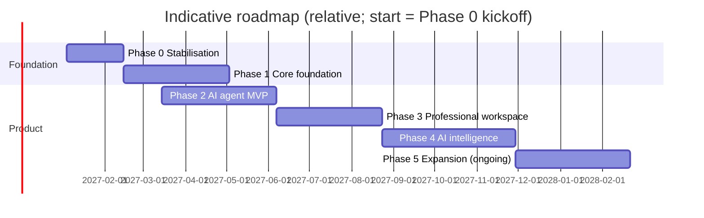
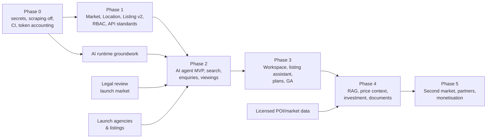

# Product Roadmap

| | |
|---|---|
| **Version** | 1.0 · 2026-11-21 |
| **Related** | [MVP_SCOPE](MVP_SCOPE.md) · [FEATURE_GAP_ANALYSIS](FEATURE_GAP_ANALYSIS.md) · [RISKS_AND_DEPENDENCIES](RISKS_AND_DEPENDENCIES.md) |

## Estimation assumptions

- **Team:** 3–4 backend engineers (Django), 1–2 frontend engineers (existing Next.js app), 1 AI/ML engineer, 1 tech lead, 0.5 DevOps, 0.5 QA, 1 PM, 1 designer, plus fractional legal and data support.
- **Durations** are elapsed‑time ranges for that team, including review, QA and stabilisation. They are **not commitments**. They assume no major rework from the unexecuted test suite (unknown until Phase 0) and timely vendor and legal inputs.
- **Phases overlap:** Phase 2 AI runtime work can start during Phase 1 once the schemas are agreed.
- Complexity: **S/M/L/XL** (see gap analysis).
- A smaller team (e.g. 2 backend engineers) roughly scales these ranges by ×1.5–2.

*Dates are placeholders showing sequencing only.*

---

## Phase 0 — Existing System Stabilisation (4–6 weeks, complexity M)

**Goals:** make the current system safe, measurable and buildable. No new product features.

| Deliverable | Gap/TR | Cx |
|---|---|---|
| Fix the CI pipeline for this repo layout; run the full test suite; publish a pass‑rate and coverage baseline; triage failures | GAP‑110/111, TR‑18 | S–M |
| Disable portal scrapers in production config; remove them from the `PropertySearchService` path; record a legal review decision | GAP‑070 | S |
| Exclude sandbox/inactive listings from all live search and AI tools; add tests | GAP‑072 | S |
| Restrict the semantic cache to non‑personal intents (or disable it) | GAP‑053, TR‑10 | S |
| Real token usage + cost capture; fix `AIInteraction` labelling; AI trace table | GAP‑052/063 | S |
| Disable `initiate_deal_lock`; add a server‑side confirmation guard to `list_property`, `connect_to_agent` and `generate_property_audit` (interim, before the new runtime) | GAP‑051 | M |
| Wire `ComplianceEngine` output checks for price/currency/location claims | GAP‑054 | S |
| Field‑level encryption for secrets and national IDs; move platform secrets to env/secret manager; rotate exposed credentials | GAP‑080/081, TR‑14 | M |
| Review committed artifacts (`media/audits/*.pdf`, `ruvector.db`, `agentdb.rvf`, `.claude-flow/`) for PII and remove them; add `.gitignore` rules | GAP‑084 | S |
| Fix the probable `properties/compare/` route shadowing; validate query params | GAP‑031/034 | S |
| Add "not a valuation" disclaimers and provenance labels to property audit outputs | FR‑VAL‑004 | S |
| Update the README (storage, deploy options, branding decision) | GAP‑114 | S |
| Freeze flags: deal lock, voice, syndication, unagreed inventory adapters | MVP §4.2 | S |

- **Technical dependencies:** KMS/secret manager; CI runners with Postgres + Redis.
- **Business dependencies:** a branding decision (PakProp vs RealTron); legal input on scraping and deal lock.
- **Risks:** unknown test failures enlarge the phase; encryption migration on live data.
- **Completion criteria:** CI green on `main`; zero plaintext secrets (schema audit); scrapers off; sandbox exclusion tests passing; AI cost dashboard showing real tokens; frozen modules off in prod config.

## Phase 1 — Core Platform Foundation (8–12 weeks, complexity L)

**Goals:** a domain model and access model that can carry a global product.

| Deliverable | Ref | Cx |
|---|---|---|
| `Market` entity + migration from the registry; remove hardcoded PK defaults; UTC server time + per‑entity TZ | TR‑04, GAP‑014/091 | M |
| Location hierarchy + PostGIS point; geocoding for launch cities; backfill with a review queue | GAP‑013/041 | L |
| Listing schema v2 (purpose, rooms, size rename, price type/period, amenities taxonomy, market attribute schema) via expand/contract | GAP‑010/012/045 | L |
| Listing lifecycle + transitions + audit + expiry | GAP‑011 | M |
| Policy‑based RBAC; consolidate memberships; active org context | GAP‑015, TR‑06 | L |
| API standards: OpenAPI, error envelope, filter validation, idempotency keys | GAP‑030–032 | M |
| Search indexes (composite, GIN, trigram) | GAP‑040 | S |
| Outbox + named queues | GAP‑043, TR‑09 | M |
| Media pipeline hardening for images | GAP‑083 | M |
| MFA for staff and org admins; OTP hashing | GAP‑082, TR‑13 | M |
| AI: provider abstraction, prompt registry, market‑pack prompt fragments (start of TR‑11) | GAP‑055/056/062 | M |

- **Dependencies:** maps/geocoding vendor; PostGIS in all environments; Phase 0 complete.
- **Risks:** migration complexity on `Property`; RBAC regressions. Mitigate with a permission matrix test suite and dual‑read periods.
- **Completion criteria:** all existing listings migrated to schema v2, with a backfill report and fewer than X % unmatched locations; the permission matrix tests pass for every role; OpenAPI is published; there are no hardcoded `PKR`/`PK`/`marla` defaults outside the PK market pack (enforced by a grep‑based check in CI).

## Phase 2 — AI Real Estate Agent MVP (8–12 weeks, complexity L)

**Goals:** the consumer value loop on web and WhatsApp.

| Deliverable | Ref |
|---|---|
| Explicit tool‑loop runtime, tool registry with policies, `PendingAction` confirmations, grounding checker v2 | AI spec §3, §5, §8 |
| Conversation API (SSE) + durable conversations/state; WhatsApp adapter migrated to the runtime | FR‑AI‑001/002/004 |
| `SearchCriteria` extraction + clarification; SearchService v2 (filters + geo + text) + ranking with explanations | FR‑AI‑003, FR‑SRCH‑*, FR‑REC‑001/003 |
| Public listing read API | GAP‑002 |
| Preference profile with consent; favourites; saved searches + alerts (email, WhatsApp) | FR‑AI‑008, FR‑REC‑002/004 |
| Basic comparison for consumers | FR‑CMP‑001/002 |
| Enquiries → leads; in‑app threads; email notifications | FR‑COM‑001–003 |
| Availability + slot booking + reminders + feedback | FR‑APT‑001–006 |
| Moderation queue for listings + user reports | G2 |
| Eval suites (EN/UR/Roman Urdu) and CI gate; failover provider; kill switch | AI spec §9 |
| Closed beta with launch agencies | Release |

- **Dependencies:** frontend chat/search/listing UI; secondary LLM contract; email provider; golden datasets; launch agencies' listings.
- **Risks:** hallucinations, latency, thin supply. Mitigate with the eval gate, tiered models, and limiting the beta to cities with supply.
- **Completion criteria:** MVP acceptance criteria 1–9 met in the closed beta ([MVP_SCOPE §6](MVP_SCOPE.md#6-mvp-acceptance-criteria)); beta cohort metrics are collected.

## Phase 3 — Professional Real Estate Workspace (8–12 weeks, complexity L)

**Goals:** make agencies successful and willing to pay.

| Deliverable | Ref |
|---|---|
| Configurable pipelines, tasks, follow‑up automation (extend existing) | FR‑CRM‑002/004 |
| Unified contact model; unified messages (consolidate WhatsApp/CRM logs) | FR‑CRM‑001, GAP‑016 |
| AI listing assistant (description, missing info, attribute extraction) | FR‑LAI‑001–003 |
| Agent performance analytics (response time, conversion) | FR‑CRM‑008 |
| Listing analytics for owners/agents | FR‑LST‑012 |
| Plans/entitlements as data; enforce limits | GAP‑100 |
| Team management and assignment rules | FR‑CRM‑007 |
| AI ops console (prompts, models, evals, traces, cost) | GAP‑103 |
| Unified audit log | GAP‑104 |
| Public launch in the primary market (consumer beta → GA) | Release |

- **Dependencies:** Phase 2 adoption data; pricing research.
- **Risks:** feature sprawl in the CRM. Prioritise with agency usage data.
- **Completion criteria:** MVP acceptance criteria 10–15; first paid conversions; agencies use the workspace weekly (metric defined in Phase 2).

## Phase 4 — AI Intelligence (10–16 weeks, complexity XL)

| Deliverable | Ref |
|---|---|
| RAG knowledge (market + org), with citations | AI spec §7 |
| AI comparison narratives; running‑cost estimates | FR‑CMP‑003/004 |
| Indicative price context with provenance and confidence (redesign of property audit) | FR‑VAL‑001–004 |
| Investment calculator + labelled commentary | FR‑INV‑001–004 |
| Document intelligence (real OCR backend + human review) | AIC‑14 |
| POI proximity search (licensed data) | FR‑SRCH‑003 |
| Persistent duplicate clustering; fraud signals v2 | FR‑LST‑010 |
| Learned re‑ranking experiments (A/B) | FR‑REC‑006 |
| Push notifications; calendar sync; offers register | FR‑COM‑004, FR‑APT‑007, FR‑CRM‑009 |

- **Dependencies:** licensed POI/market data; sufficient interaction volume; OCR vendor.
- **Risks:** data licensing costs; valuation‑claim liability.
- **Completion criteria:** each feature passes its eval/grounding suite; disclaimers have legal sign‑off.

## Phase 5 — Marketplace Expansion (ongoing, quarterly increments)

| Track | Deliverables |
|---|---|
| Second market (UAE) | Market pack completion, Arabic/RTL, licence fields (e.g. RERA/BRN), local legal review, local agencies |
| Monetisation | Usage‑based AI add‑ons, featured listings (labelled), developer packages, API access |
| Partner services | Mortgage/insurance/movers referral directory with disclosures |
| Advanced AI | Proactive concierge; voice agent (if validated); cross‑border discovery |
| Frozen modules revisit | Deal lock via a licensed escrow partner; syndication for developers |
| Scale | Read replica, log partitioning, search engine evaluation (if triggers are met) |

- **Completion criteria per market:** launch readiness checklist ([MVP_SCOPE §7](MVP_SCOPE.md#7-launch-readiness-checklist)) repeated per market.

## Cross‑phase dependency map

## Milestones

| Milestone | Exit signal |
|---|---|
| M0 "Safe baseline" | Phase 0 completion criteria |
| M1 "Global‑ready core" | Phase 1 completion criteria |
| M2 "Closed beta" | AI agent MVP live with launch agencies |
| M3 "Public launch (primary market)" | MVP acceptance criteria fully met |
| M4 "Intelligence" | Phase 4 features GA |
| M5 "Second market live" | UAE launch readiness complete |
