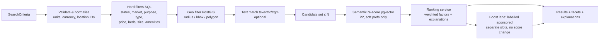

# Technical Recommendations

| | |
|---|---|
| **Version** | 1.0 · 2026-11-21 |
| **Baseline** | `pakpropai` @ `0b574a7` |
| **Related** | [EXISTING_SYSTEM_ASSESSMENT](EXISTING_SYSTEM_ASSESSMENT.md) · [API_AND_DATA_REQUIREMENTS](API_AND_DATA_REQUIREMENTS.md) · [AI_CAPABILITIES_SPECIFICATION](AI_CAPABILITIES_SPECIFICATION.md) |

Each recommendation (TR‑NN) covers: **current state (evidence) → why insufficient → proposal → benefit → migration/compatibility → complexity → dependencies → MVP‑critical?** Complexity: S/M/L/XL as in the gap analysis.

> **Guiding principle:** improve incrementally. The existing Django/DRF/Postgres/Redis/Celery/Channels stack is appropriate for this product and a small-to-mid team. **No rewrite and no microservices are recommended.** New packages and extensions below are recommendations only; adding them is an implementation decision outside this documentation task.

---

## 1. Architecture: keep the modular monolith, enforce boundaries (TR‑01)

- **Current:** 26 Django apps with frequent function‑local cross‑imports (e.g. `apps.ai.tools` imports from properties, leads, escrow, audit, verification, config). Business logic is spread across views, tools and services.
- **Why insufficient:** hidden coupling makes changes risky, especially for the AI tools, which touch every domain.
- **Proposal:** group the apps into ~12 bounded contexts with explicit public interfaces (`services.py` / `api.py` per context). Forbid importing another context's models or views directly, and enforce this with an import linter in CI. Cross‑context side effects go through domain events (outbox, TR‑09).
- **Benefit:** safer parallel work, testable AI tools, and a future extraction path if ever needed.
- **Migration:** non‑breaking. Introduce facades first, then migrate call sites gradually.
- **Complexity:** M (ongoing). **Dependencies:** none. **MVP‑critical:** yes for the AI/tool boundary; gradual elsewhere.

**Triggers that would justify extracting a service later** (not now): AI runtime needs independent scaling or a different runtime; search moves to a dedicated engine with its own indexer; telephony/voice media streaming; teams > ~25 engineers with conflicting release cadence.

## 2. Target architecture diagram

```mermaid
flowchart TB
    subgraph Clients
        WEBAPP[Web / mobile apps]
        WAC[WhatsApp]
        PART[Partner API clients]
        VOICE[Voice - P3]
    end

    subgraph Edge
        CDN[CDN + WAF]
    end

    subgraph Monolith["Django modular monolith (stateless, horizontally scaled)"]
        direction TB
        API[REST /api/v1 + SSE/WebSocket]
        subgraph Contexts
            IAM[Identity & Access]
            TEN[Tenancy / Orgs]
            MKT[Markets & Localisation]
            LST[Listings]
            SRCH[Search & Discovery]
            CONV[Conversation & AI Runtime]
            CRM[CRM: Leads, Tasks, Pipelines]
            SCH[Scheduling]
            COMM[Communications: WA, email, push, SMS]
            TRUST[Trust & Verification]
            BILL[Billing & Entitlements]
            PRIV[Compliance & Privacy]
            ANA[Analytics & Reports]
            OPS[Platform Ops / Admin]
        end
        OUTBOX[(Outbox events)]
    end

    subgraph Async
        Q[Celery queues: ai, notifications, media, sync, default]
        BEAT[Beat scheduler - UTC]
    end

    subgraph Data
        PG[(PostgreSQL + PostGIS + pgvector)]
        RR[(Read replica - when needed)]
        RD[(Redis: cache, rate limits, sessions, channels)]
        OBJ[(Object storage: public media / private docs)]
    end

    subgraph AIProviders["AI providers (abstracted)"]
        M1[Primary LLM]
        M2[Fallback LLM]
        EMB[Embedding model]
        STT[STT/OCR]
    end

    subgraph Vendors
        MAPS[Maps / geocoding / POI]
        FX[FX rates]
        IDV[IDV]
        PAY[Payments]
        MSG[Email / push / SMS]
        FEEDS[Licensed listing feeds]
    end

    Clients --> CDN --> API
    API --> Contexts
    Contexts --> PG & RD & OBJ
    Contexts --> OUTBOX --> Q
    Q --> Contexts
    CONV --> M1 & M2 & EMB
    TRUST --> STT & IDV
    LST --> MAPS
    SRCH --> PG
    COMM --> MSG & WAC
    BILL --> PAY
    MKT --> FX
    LST --> FEEDS
```

## 3. Domain/module boundaries (mapping from existing apps)

| Context | Existing apps | Notes |
|---|---|---|
| Identity & Access | `users`, parts of `core.permissions` | New permission registry (TR‑06) |
| Tenancy / Orgs | `organizations`, `agents` (membership parts), `core.middleware` tenant | Consolidate memberships |
| Markets & Localisation | `markets`, `config` (market parts) | Market entity (TR‑04) |
| Listings | `properties` (model, images), `inventory` | Listing schema v2 |
| Search & Discovery | `properties.search`, `properties.recommendations` | Ranking service |
| Conversation & AI | `ai`, `whatsapp.copilot_stream`, `ml` | Runtime (TR‑11) |
| CRM | `leads`, `agents` (profiles, availability) | Pipelines, tasks |
| Scheduling | `leads.Appointment` | Slot engine |
| Communications | `whatsapp` (transport), `notifications`, `campaigns`, `voice` | Channel adapters |
| Trust & Verification | `verification`, `audit` (security traces), `compliance.aml` | |
| Billing | `billing`, `payments`, `escrow` (frozen), `marketplace` (frozen) | |
| Compliance & Privacy | `compliance`, `infra` | |
| Analytics | `reports`, `audit` (property audits → price context) | |
| Platform Ops | `config`, `security`, `observability`, `resilience`, admin | |

## 4. Market configuration layer (TR‑04)

- **Current:** `apps/markets/registry.py` `MarketConfig` dataclass for PK/AE/GB/US, plus scattered defaults (`currency='PKR'`, `country='PK'`, `area_unit='marla'`, `TIME_ZONE='Asia/Karachi'`, `_DEFAULT_CITY_CODE_MAP`, PK cities in `agent.py`, crore/lakh regexes in `service.py`).
- **Why insufficient:** adding a market needs code edits in many places, and defaults silently produce Pakistani behaviour for non‑PK users.
- **Proposal:** a `Market` DB model (status, currencies, languages, units, TZs, formats, listing JSON schema, disclaimers, document types, feature flags, AI policy overrides) + code plugins per market (`apps/markets/<cc>/`) for calculators, parsers (e.g. lakh/crore), keyword packs and prompt fragments. Remove hardcoded PK defaults in favour of `market.default_*`.
- **Migration:** create markets PK/AE/GB/US from the registry; backfill `market_id` from `country`; keep the `country` columns.
- **Complexity:** M. **MVP‑critical:** yes.

## 5. Database recommendations (TR‑05)

| # | Recommendation | Current | Benefit | Migration | Cx | MVP |
|---|---|---|---|---|---|---|
| 5.1 | **PostGIS**: `geography(Point)` on listings/locations, GiST index | Decimal lat/lon, no index | Radius/bbox/polygon search; distance sort | Add column, backfill from lat/lon, keep decimals one release | M | Yes |
| 5.2 | **Location hierarchy** `Location(id, market, parent, level, name, slug, aliases[], geom, centroid)` | Free text | Consistent filtering, SEO, i18n names | Geocode/match existing city+location strings; manual review queue for unmatched | L | Yes |
| 5.3 | **Full‑text**: stored `tsvector` (per‑language config) + GIN; `pg_trgm` for fuzzy location | `SearchVector` computed per query | 10–100× faster text search `[Inferred]` | Generated column / trigger | S | Yes |
| 5.4 | **Composite indexes** for the hot filter path, e.g. `(market_id, status, purpose, category, price)` and partial index `WHERE status='published'` | Single columns | Predictable latency | `CREATE INDEX CONCURRENTLY` | S | Yes |
| 5.5 | **pgvector** for knowledge chunks and optional listing embeddings | None | RAG + semantic retrieval without a new datastore | Extension + tables | S | P2 |
| 5.6 | **Expand/contract migrations** for `area_marla → size_value`, price split, membership consolidation | — | Zero‑downtime | Add new → dual‑write → backfill → switch reads → drop | M | Yes |
| 5.7 | **Money convention**: amounts as integer minor units + currency, with `Currency.minor_units` | BigInteger major units | Correct for currencies with decimals | Multiply on migrate per currency | S | Yes |
| 5.8 | **Partition/retention** for `ai_interactions`, `whatsapp_messages`, security events, celery results | Unbounded | Cost and performance | Monthly partitions; retention jobs | M | P2 |
| 5.9 | **Read replica** for analytics/reports | Single DB | Isolation | Router for read‑only views | S | P2+ |
| 5.10 | **FKs instead of CharField org IDs** in `SecurityTrace`, `ComplianceViolation` | CharField | Integrity | Add nullable FK; backfill | S | P2 |

**Scale assumption:** Postgres with these indexes handles the MVP and Phase 3 volumes (`ASSUMPTION:` up to roughly low millions of listings and a modest QPS). Move search to a dedicated engine only if p95 search latency exceeds the SLO with tuned indexes, or if faceting/typo tolerance across languages becomes a product requirement that Postgres can't meet.

## 6. Authorization and RBAC (TR‑06)

- **Current:** `User.role` (4 values) + `platform_role` (6) + `OrganizationMembership.role` (8) + `AgentOrgMembership` + `AgentOrganizationMembership` + `Agent.organization` + `Organization.admin_user` (OneToOne, which limits a user to administering one org). Views branch on `user.role == 'developer'`. `get_user_org(user)` returns a single org. The `USE_MEMBERSHIP_RBAC` flag mentioned in the docstring is unused.
- **Why insufficient:** users can't belong to multiple orgs cleanly, permissions are scattered, and there are no market‑scoped admins.
- **Proposal:**
  1. **Permission registry** (`listings.publish`, `leads.assign`, `ai.prompts.edit`, …) defined in code.
  2. **Roles as data** (platform defaults + org‑custom roles later) mapping to permissions.
  3. **Scoped role assignments:** `RoleAssignment(user, role, scope_type ∈ {platform, market, organization, team}, scope_id)`.
  4. **Policy functions** for object rules (e.g. agent can edit listings they are assigned to). These are used by DRF permission classes and AI tool policies alike.
  5. An **active org context** header (`X-Org-Id`) validated against memberships, replacing `get_user_org`.
- **Migration:** map existing `role/platform_role/memberships` to assignments; keep `User.role` as a derived read‑only field for one release.
- **Complexity:** L. **MVP‑critical:** yes (P0). This blocks agency teams and market admins.

## 7. API standards (TR‑07)

| Standard | Recommendation |
|---|---|
| Schema | Generated OpenAPI 3.1, published per environment; contract tests in CI |
| Errors | `{"error": {"code": "listing.invalid_transition", "message": "...", "fields": {...}, "request_id": "..."}}` |
| IDs | UUID (or public UUID for int‑PK tables) in all URLs |
| Pagination | Cursor for feeds/search; page for small admin lists |
| Filtering | Declarative filter classes with validation (no bare `int()` casts) |
| Idempotency | `Idempotency-Key` required on POSTs that create enquiries, bookings, payments, listings via API keys |
| Versioning | `/api/v1` major in URL; additive evolution; `Deprecation` and `Sunset` headers; v2 only on breaking change |
| Time & money | ISO 8601 UTC; `{amount_minor, currency}` + formatted display string |
| Localisation | `Accept-Language` + user/market defaults |
| Rate limits | Existing scoped throttles `[EXISTS]`; add `RateLimit-*` headers |
| Webhooks (outbound) | Signed (HMAC), retried with backoff, delivery log (existing `WebhookDeliveryRecord` `[EXTEND]`) |
| GraphQL | **Not recommended**; REST + typed schema is sufficient |

## 8. Search architecture (TR‑08)

- **Hybrid in Postgres first**; vector similarity is applied only to the filtered candidate set and only for soft preferences.
- **Ranking weights** are config per market (admin‑editable, versioned) for reproducibility and A/B tests.
- **Cache:** results keyed by `hash(criteria, market, ranking_version)` for 60–300 s; invalidated on listing publish/update events.
- **Remove scrapers** from `PropertySearchService`. Licensed external listings enter as normal `Listing` rows with `source` and `licence_id`, so they go through the same moderation and ranking.

## 9. Events and queues (TR‑09)

- **Current:** direct `.delay()` calls inside request paths and model logic; two queues.
- **Proposal:** a transactional **outbox** (`OutboxEvent(id, type, payload, created_at, dispatched_at)`) written in the same DB transaction as the state change; a dispatcher publishes to Celery. Named queues: `ai` (LLM calls), `media` (image processing, OCR), `notifications`, `sync` (feeds), `default`. Dead‑letter handling via a `FailedTask` table and admin retry.
- **Key events:** `listing.published`, `listing.updated`, `listing.expired`, `enquiry.created`, `lead.assigned`, `appointment.booked`, `message.received`, `ai.tool_invoked`, `user.deleted`.
- **Benefit:** no lost side effects on rollback, and it addresses the chaos‑report finding (no buffering/retry under DB starvation).
- **Complexity:** M. **MVP:** P1.

## 10. Caching (TR‑10)

| Cache | Scope | TTL | Notes |
|---|---|---|---|
| Conversation working state | per conversation | 24 h, backed by Postgres | Redis as accelerator only |
| Search results | criteria hash + market | 60–300 s | Event invalidation |
| Market/config | global | 5 min + bust on change | `SystemConfigService` `[EXISTS]` |
| FX rates | per day | 24 h | |
| **Semantic response cache** | **only for intents flagged `cacheable_public` (generic FAQs, market facts), keyed by market + language + prompt version** | 24 h | **Never** for replies containing user, lead, listing‑availability or deal data |
| Guardrail decisions | message hash | short | `[EXISTS]` |

## 11. AI runtime (TR‑11)

Summary (full spec in [AI_CAPABILITIES_SPECIFICATION](AI_CAPABILITIES_SPECIFICATION.md)):

- Replace Gemini **Automatic Function Calling** with an **explicit tool loop** (the provider returns tool calls, and the platform validates, authorises, confirms, executes, logs, and returns results). Max steps per turn (e.g. 5) and a per‑turn token budget.
- `LLMProvider` interface (`generate`, `generate_structured`, `stream`, `embed`, `vision`, `transcribe`) with adapters for the current Gemini and Ollama backends plus at least one more provider for failover. Model routing by task (cheap model for extraction/classification, stronger model for complex reasoning).
- `PromptTemplate`/`PromptVersion` registry with market and language overrides, referenced on every logged call.
- Capture **real usage** (`usage_metadata` or the equivalent) for tokens and cost.
- Keep existing assets: `GuardrailEngine`, `IntentClassifier` (as a cheap pre‑router), `DynamicContextBuilder`, market knowledge, circuit breaker, eval harness.
- **Complexity:** L. **MVP‑critical:** yes.

## 12. Storage and media (TR‑12)

- **Current:** Cloudinary storage when configured, otherwise local `media/`. Images are validated by declared MIME and size. Generated PDFs are written to `media/audits/` (and two are committed to git).
- **Proposal:** S3‑compatible object storage (or keep Cloudinary for public images) with **two buckets**: a public‑read bucket behind a CDN for listing images, and a private bucket for documents/IDs/reports with short‑lived signed URLs. Media pipeline task: content sniffing, re‑encode, strip EXIF/GPS, generate sizes, perceptual hash (dedup), and AV scan for documents.
- **Complexity:** M. **MVP:** P1 (images hardened); documents P2.

## 13. Authentication (TR‑13)

Keep phone OTP + JWT (fits WhatsApp‑first markets). Add: email + password and magic link (P1 for professionals), OAuth Google/Apple (P2), TOTP MFA mandatory for platform staff and org owners/admins (P1), session/device list with revoke (P2), refresh‑token rotation (already uses blacklist `[EXISTS]`). Hash OTP codes at rest (currently stored plain in `otp_codes.code`).

## 14. Security (TR‑14)

| # | Recommendation | Evidence | Pri |
|---|---|---|---|
| 14.1 | **Field‑level encryption** (envelope encryption with a cloud KMS) for `SystemConfig` sensitive keys, `OrgWhatsAppConfig.access_token/app_secret/verify_token`, `OrgPaymentSettings` secrets, `OrgVoiceConfig.auth_token`, national IDs (`User.cnic`, `DocumentScan.cnic_number`), `raw_ocr` | Plain CharFields; no encryption lib found | P0 |
| 14.2 | Prefer env/secret manager for platform credentials; DB only for per‑org credentials (encrypted) | `SystemConfig` stores API keys | P0 |
| 14.3 | Secret rotation procedure; WhatsApp token health check `[EXISTS]` extended to alert on expiry | | P1 |
| 14.4 | Tool execution security: policy check + confirmation + audit (AI spec §3) | AFC | P0 |
| 14.5 | Upload security pipeline (TR‑12) | | P1 |
| 14.6 | Dependency and container image scanning in CI (in addition to Bandit/TruffleHog `[EXISTS]`) | | P1 |
| 14.7 | Audit log for admin actions and data access to PII; keep the hash chain `[EXISTS]` | | P1 |
| 14.8 | Bot/abuse: per‑phone WhatsApp limits `[EXISTS]`, plus web CAPTCHA on OTP send, device fingerprint risk score | | P1 |
| 14.9 | Review committed artifacts (`media/audits/*.pdf`, `ruvector.db`, `agentdb.rvf`, `.claude-flow/`) for PII; remove and scrub history if needed (repository owner action) | git ls-files | P0 |
| 14.10 | Penetration test before public launch (existing `test_security_pentest.py` is a start) | | P1 |
| 14.11 | CSRF tests for cookie‑JWT unsafe methods | `CSRF_COOKIE_HTTPONLY=False` | P1 |

## 15. Observability (TR‑15)

Keep Prometheus/Grafana/OTel/Sentry and the JSON logs `[EXISTS]`. Add: **SLOs** (API availability, search p95, AI reply p95, webhook processing success, notification delivery); **AI traces** with prompt version, model, tokens, cost, tool calls, guardrail results and grounding result; business dashboards (enquiries, response times); alert routing and runbooks. Fix `AIInteraction.interaction_type` mislabelling.

## 16. Scalability (TR‑16)

Stateless web pods behind a load balancer; separate worker pools per queue (AI workers scale on queue depth); Channels on its own ASGI pool; Redis with persistence for Channels and cache (separate logical DBs or instances for broker vs cache); Postgres connection pooling (PgBouncer) as workers grow (`CONN_MAX_AGE=60` today). Replace "rescore all properties nightly" with event‑driven scoring.

## 17. Resilience (TR‑17)

LLM failover (TR‑11); idempotent Celery tasks (`acks_late`, idempotency keys); outbox retries; circuit breakers `[EXISTS]` per vendor; graceful degradation (AI down → deterministic search + human handoff); **backups** with point‑in‑time recovery and quarterly restore drills; documented RPO/RTO (`ASSUMPTION:` RPO ≤ 15 min, RTO ≤ 4 h for MVP); fix chaos findings (buffering and retries under DB starvation).

## 18. Deployment & CI/CD (TR‑18)

| Issue | Evidence | Fix |
|---|---|---|
| Workflow assumes a parent monorepo (`working-directory: pakpropai`, `context: pakpropai`, `pakpropaiweb`) but the git root is `pakpropai` | `.github/workflows/ci.yml` | Either move the workflow to a monorepo root that contains both projects, or rewrite the paths for this repo and split the frontend pipeline |
| `infra/scripts/health_check.py` missing | `ls infra` → absent | Add the script or replace it with an inline health check |
| Branches `main, develop`, but the working branch is `development` | git status | Align branch names |
| README references `render.yaml` (absent) and R2 (code uses Cloudinary) | README vs settings | Update docs |
| Root `Dockerfile` defaults to dev settings + runserver | Dockerfile | Keep for dev; production uses `docker/Dockerfile.web` `[EXISTS]` |
| Migration rollback check rolls back only `users` | CI | Document as a smoke check; add a `makemigrations --check` gate `[EXISTS]` |

Add: an eval gate job (AI regression) on changes to `apps/ai/**`, prompts or model config; OpenAPI diff check; image scanning; staged deploys (staging → canary → prod) with automated rollback `[EXISTS for ECS]`; infrastructure as code (Terraform is referenced in comments but not in this repo).

## 19. Testing strategy (TR‑19)

| Layer | Scope | Gate |
|---|---|---|
| Unit | Services, calculators, policies, parsers | Coverage target per context (e.g. ≥80 % for listings, search, access, AI runtime) |
| API/contract | OpenAPI conformance, permissions matrix tests per role | Required |
| Integration | Postgres (PostGIS/pgvector), Redis, Celery eager vs real | Required |
| AI eval | Golden sets: extraction, tool selection, grounding, refusal, multilingual, fairness | Release gate on thresholds |
| Security | Bandit, secrets scan `[EXISTS]`, dependency scan, authz fuzzing, pentest pre‑launch | Required |
| Load | k6 scripts `[EXISTS]` extended for search and chat | Pre‑release |
| Chaos | Existing scripts `[EXISTS]` | Quarterly |
| E2E | Critical journeys (discover → enquire → book) with frontend | Pre‑release |

**First action:** run the existing 1,435 tests in a clean CI and record the pass rate and coverage. This assessment did not execute them.

## 20. Integrations architecture (TR‑20)

Each external vendor sits behind a port/adapter interface inside its context (pattern already used for `verification/providers`, `voice/providers`, `inventory/adapters`, `ai/backends` `[EXISTS]`). Each adapter needs: a circuit breaker, timeouts, retries, a cost counter, sandbox/live config per market, and contract tests with recorded fixtures. See [API_AND_DATA_REQUIREMENTS §5](API_AND_DATA_REQUIREMENTS.md#5-external-integrations-and-data-sources) for the integration catalogue.

---

## 21. Recommendation summary

| TR | Title | Cx | MVP‑critical |
|---|---|---|---|
| TR‑01 | Enforce modular boundaries | M | Partly |
| TR‑04 | Market configuration layer | M | Yes |
| TR‑05 | DB: PostGIS, location tree, FTS/GIN, composite indexes, expand/contract | L | Yes |
| TR‑06 | Policy‑based RBAC consolidation | L | Yes |
| TR‑07 | API standards (OpenAPI, errors, idempotency) | M | Yes |
| TR‑08 | Hybrid search + ranking service; remove scrapers | L | Yes |
| TR‑09 | Outbox + named queues | M | P1 |
| TR‑10 | Cache scoping (semantic cache fix) | S | Yes (P0) |
| TR‑11 | AI runtime (explicit tool loop, providers, prompts, usage) | L | Yes |
| TR‑12 | Media pipeline and private storage | M | P1 |
| TR‑13 | Auth additions (MFA, email, OTP hashing) | M | P1 |
| TR‑14 | Security hardening (encryption, artifacts) | M | Yes (P0) |
| TR‑15 | Observability SLOs + AI traces | M | Yes |
| TR‑16–17 | Scalability and resilience | M | P1–P2 |
| TR‑18 | CI/CD fixes | S | Yes (P0) |
| TR‑19 | Testing strategy + baseline | M | Yes |
| TR‑20 | Integration adapters | M | P1 |
